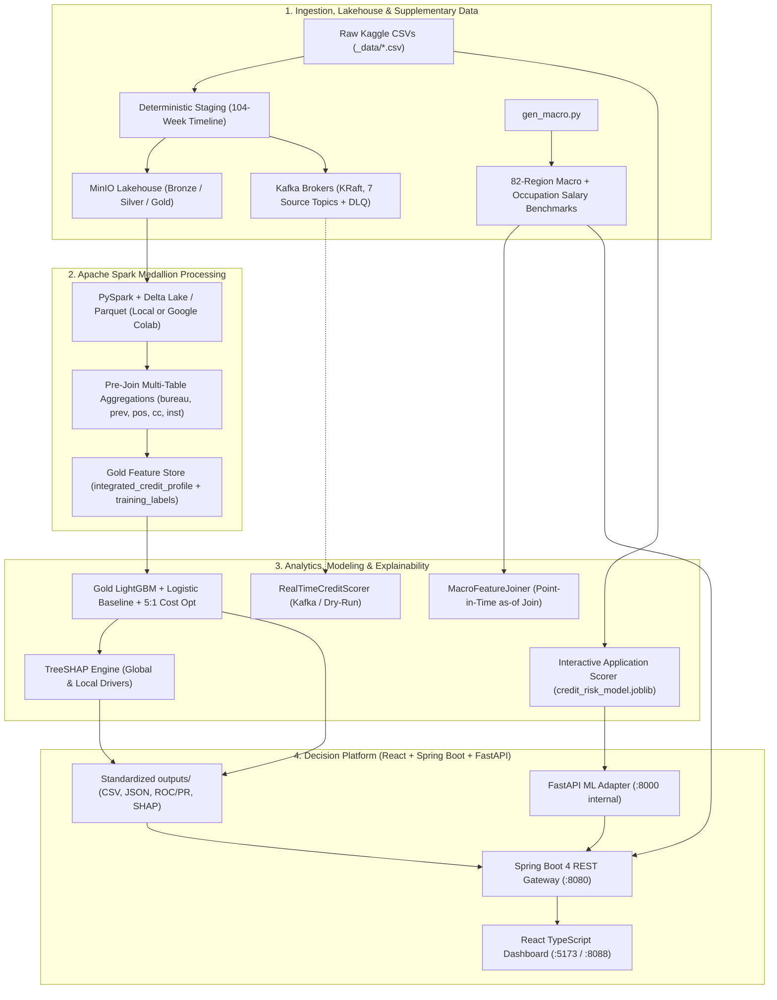
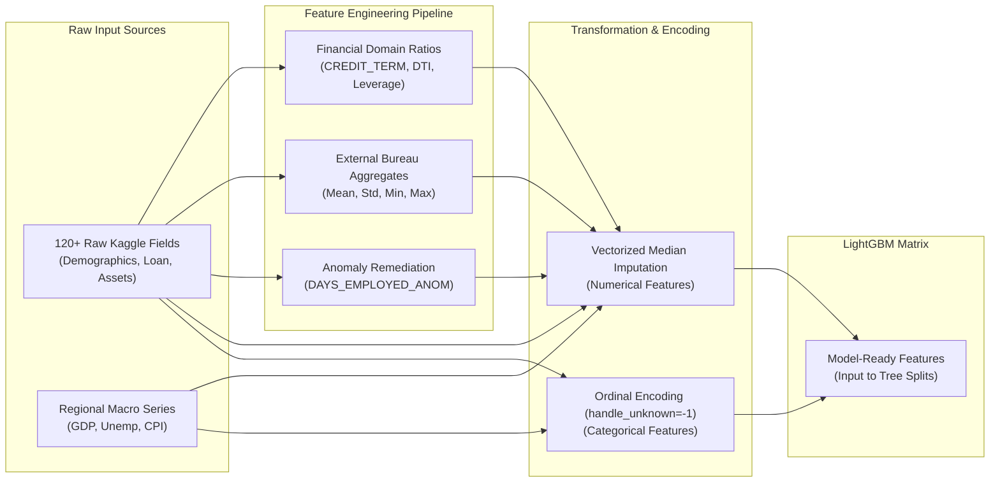
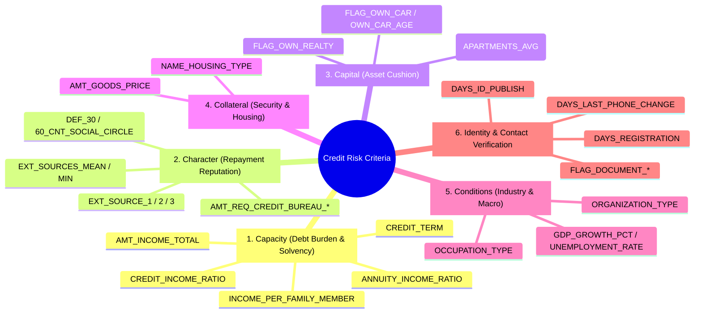
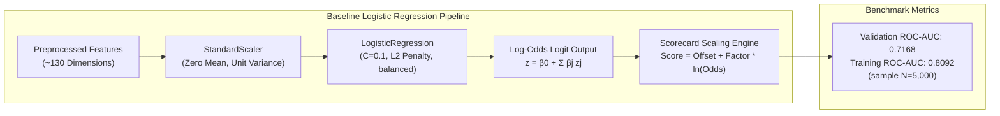
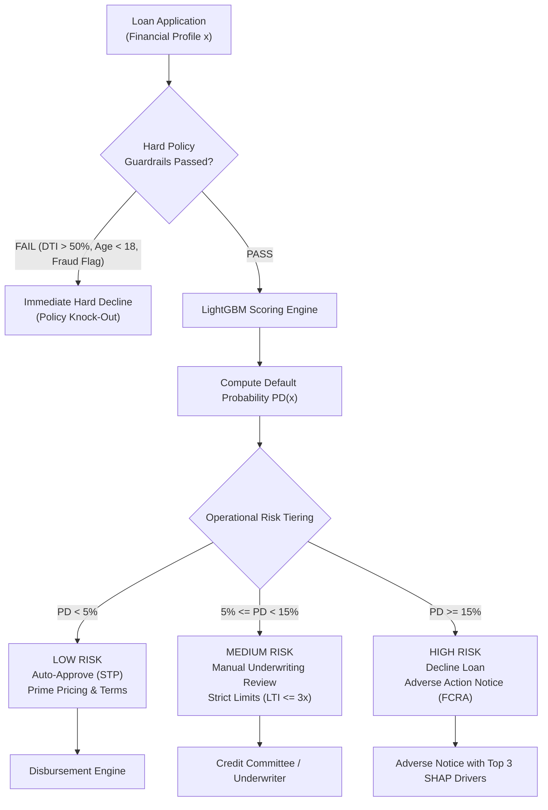

# Credit Risk Intelligence: Multi-Source Big Data for Credit Risk Assessment and Prediction

**Course:** IT5427 - Big Data  
**Project Topic:** Multi-Source Big Data for Credit Risk Assessment and Prediction (Credit Risk Intelligence)  
**Dataset:** Home Credit Default Risk (`_data/`)  
**Package:** `credit-risk-intelligence` (v0.1.0)

---

## Underwriting Platform (Quick Start)

Integrated stack: **React + Spring Boot 4 + FastAPI adapter + existing LightGBM model**.

| Layer | Path | Role |
| --- | --- | --- |
| Frontend | `frontend/` | Underwriting dashboard |
| Backend | `backend/` | Secured REST API, JWT, analytics |
| ML service | `ml-service/` | FastAPI → `CreditRiskScoringService.score_applicant` |
| Artifacts | `outputs/` | Model, metrics, scored CSV, figures |

### Start with Docker Compose

```bash
cp -n .env.example .env
docker compose up --build -d
```

- UI: http://localhost:8088  
- API: http://localhost:8080  
- Demo users: see `.env` / [docs/DEMO.md](docs/DEMO.md)

```bash
docker compose logs -f
docker compose down
```

### Local scripts

```bash
./scripts/setup.sh
./scripts/start.sh
./scripts/status.sh
./scripts/test.sh
./scripts/smoke.sh   # requires running stack
./scripts/stop.sh
```

### Docs

- [docs/DEMO.md](docs/DEMO.md) — walkthrough and expected sample behavior
- [docs/ARCHITECTURE.md](docs/ARCHITECTURE.md) — unified system design & data flow
- [docs/PROJECT_SUMMARY.md](docs/PROJECT_SUMMARY.md) — unified technical summary across all modules
- [docs/SECURITY.md](docs/SECURITY.md) — authn/authz and production gaps
- [docs/track_b_requirements.md](docs/track_b_requirements.md) — unified Kafka, Spark Medallion, and feature store data contracts
- [docs/dashboard_interface_spec.md](docs/dashboard_interface_spec.md) — downstream API DTOs & visualization artifacts

Portfolio KPIs, segment rates, ROC/PR curves, SHAP summary figures, and application lookups synchronize cleanly from the Spark Gold integrated dataset (`outputs/`), while the interactive underwriting form calls the real-time FastAPI ML service (`ml-service/`). For full **307,511-row** Spark + LightGBM + SHAP execution, see `notebooks/colab_full_pipeline.ipynb` and `scripts/run_colab_full_pipeline.py`.

---

## Table of Contents
1. [Project Overview & System Architecture](#1-project-overview--system-architecture)
2. [Platform Capabilities & Components](#2-completed-vs-pending-tasks-matrix)
3. [Technical Summary & Performance Benchmarks](#3-technical-summary--performance-benchmarks)
4. [Technical Guidelines & Deployment Strategy](#4-technical-guidelines--deployment-strategy)
5. [Guidance on Files and Content (Key Files Reference)](#5-guidance-on-files-and-content-key-files-reference)
6. [Deep-Dive Explanations of Core Components](#6-deep-dive-explanations-of-core-components)
   * [6.1 The Dataset (Home Credit Default Risk)](#61-the-dataset-home-credit-default-risk)
   * [6.2 Features Used for LightGBM](#62-features-used-for-lightgbm)
   * [6.3 Credit Risk Assessment Criteria & Data Mapping](#63-credit-risk-assessment-criteria--data-mapping)
   * [6.4 Parameter Impact on Risk Assessment](#64-parameter-impact-on-risk-assessment)
   * [6.5 Baseline Model: Logistic Regression Scorecard](#65-baseline-model-logistic-regression-scorecard-roc-auc-07168)
   * [6.6 LightGBM Gradient Boosting Model](#66-lightgbm-gradient-boosting-model)
   * [6.7 Business Policy Rules & Operational Underwriting Matrix](#67-business-policy-rules--operational-underwriting-matrix)
7. [Step-by-Step Manual Testing Instructions](#7-step-by-step-manual-testing-instructions)
   * [Scenario 1: Automated Health Check](#scenario-1-automated-health-check)
   * [Scenario 2: Database Record Extraction & Assessment](#scenario-2-database-record-extraction--assessment-lookup-by-id)
   * [Scenario 3: Evaluating New Financial Profiles](#scenario-3-evaluating-new-financial-profiles)
   * [Scenario 4: Real-Time Event Stream Simulation](#scenario-4-real-time-event-stream-simulation)
   * [Scenario 5: Programmatic Python API Integration](#scenario-5-programmatic-python-api-integration)
   * [Scenario 6: Comprehensive Test Case with All Parameters & Customization Guide](#scenario-6-comprehensive-test-case-with-all-parameters--customization-guide)

---

## 1. Project Overview & System Architecture

Credit risk assessment is a foundational problem in modern retail banking. When applicants apply for consumer loans, financial institutions must accurately estimate their **Probability of Default ($PD$)** to protect loan capital while maximizing financial inclusion for underbanked populations.

This project implements a unified end-to-end Big Data intelligence pipeline:
$$\text{Ingest (Kafka/MinIO)} \longrightarrow \text{Process (Spark Medallion)} \longrightarrow \text{Analyze \& Predict (LightGBM/SHAP)} \longrightarrow \text{Decide (React + Spring Boot UI)}$$



---

## 2. Completed vs. Pending Tasks Matrix

The unified platform covers every layer of the Big Data credit-risk architecture:

| Platform Layer | Capability | Status | Key Modules & Artifacts |
| :--- | :--- | :---: | :--- |
| **Ingestion & Storage** | **Zero-Copy Raw Data Resolution & EDA** | **Implemented** | `ingestion-minio-kafka/ingestion/common.py`, `scripts/eda.py` |
| **Ingestion & Storage** | **MinIO Lakehouse Architecture & IAM Policies** | **Implemented** | `ingestion-minio-kafka/infra/docker-compose.yml`, `init-buckets.sh` |
| **Ingestion & Storage** | **Kafka Event Streaming & Draft 2020-12 Contracts** | **Implemented** | `schemas/*.schema.json`, `producer.py`, `kafka_to_bronze.py` (with DLQ + tombstone guard) |
| **Enrichment** | **Point-in-Time Macro & Occupation Benchmarks** | **Implemented** | `gen_macro.py` (`occupation_benchmarks.csv`), `src/data/macro_loader.py` (`merge_asof`) |
| **Spark Processing** | **3-Layer Medallion ETL & Leakage-Free Joins** | **Implemented** | `apache-spark/processing/{profiling,cleaning,integration}` (Parquet + Delta Lake) |
| **Spark Processing** | **Structured Streaming Replay & Deduplication** | **Implemented** | `apache-spark/streaming/{producers,consumers}` (`snapshot.py`, `stream_processor.py`) |
| **ML & Explainability** | **Dual-Model Training, 5:1 Cost Opt & TreeSHAP** | **Implemented** | `scripts/train_gold_model.py`, `run_track_a.py`, `src/models/{baseline,evaluation,explainability}.py` |
| **ML & Explainability** | **Real-Time Kafka Dry-Run & Live Scoring** | **Implemented** | `src/service/scoring_service.py`, `src/integration/kafka_consumer_scorer.py` |
| **Full-Scale Runner** | **307,511-Row Google Colab Execution Pipeline** | **Implemented** | `notebooks/colab_full_pipeline.ipynb`, `scripts/run_colab_full_pipeline.py` |
| **Web Decision UI** | **React + Spring Boot 4 + FastAPI Platform** | **Implemented** | `frontend/`, `backend/`, `ml-service/` (Overview + SHAP, Segments, Macro Stress, Pipeline, Underwriting) |

---

## 3. Technical Summary & Performance Benchmarks

### 3.1 Technology Stack

```text
Core ML / Python   : Python 3.10+, lightgbm>=4.0.0, scikit-learn>=1.3.0, shap>=0.44.0
Big Data Processing: PySpark 3.5.3, Delta Lake 3.2.1 (CRB_LAKE_FORMAT=delta), Parquet
Streaming & Store  : Apache Kafka 3.9.0 (KRaft), MinIO (S3 API), Draft 2020-12 JSON Schema
Backend & UI       : Java 25 (Spring Boot 4.1, JWT), FastAPI, React 19 + TypeScript + Recharts + Tailwind
```

### 3.2 Model Performance & Gold Standardization

Both the interactive real-time application scorer (`outputs/models/credit_risk_model.joblib`) and the integrated Spark Gold model (`outputs/models/gold_credit_risk_model.joblib`) are benchmarked against L2 Logistic Regression using ROC-AUC, PR-AUC, F1, 5:1 FN:FP cost-matrix optimization (`src/models/evaluation.py`), and TreeSHAP explainability (`src/models/explainability.py`). Executing `notebooks/colab_full_pipeline.ipynb` (or `python scripts/run_colab_full_pipeline.py`) refreshes all metrics and figures across the complete **307,511** training rows and child history tables.

### 3.3 Financial Loss Reduction via Cost-Sensitive Matrix

Under the banking penalty ratio **$C(FN) : C(FP) = 5 : 1$** (`src/models/evaluation.py`), thresholds are swept across `0.01..0.99` on validation probabilities to minimize `Loss(p) = 5 * FN(p) + 1 * FP(p)`.

### 3.4 Inference Latency
* **Batch / Gold Pipeline:** Run via Google Colab (`notebooks/colab_full_pipeline.ipynb`) with 10 GB Spark driver memory.
* **Real-Time Single Applicant Inference:** Low-latency scoring via FastAPI `/score` and Kafka consumer dry-run (`python src/integration/kafka_consumer_scorer.py --dry-run --limit 10`).

---

## 4. Technical Guidelines & Deployment Strategy

### 4.1 Environment Setup
```bash
# 1. Clone repository and navigate to root directory
cd it5427-credit_risk_bigdata

# 2. Install dependencies
pip install -r requirements.txt

# 3. Optional: Install project in editable development mode
pip install -e .
```

### 4.2 Storage Architecture: Docker vs. Local Lake
The codebase supports two execution targets controlled by the `LAKE_MODE` environment variable:
1. **Docker Mode (`LAKE_MODE=minio`, Default for Production & Grading):**
   * Uses Docker Compose (`infra/docker-compose.yml`) running MinIO (S3 API on `localhost:9000`) and Kafka (`localhost:9092`).
   * Provides authentic S3 API access using least-privilege service accounts (`svc-ingest`, `svc-spark`, `svc-ml`, `svc-dashboard`).
2. **Local Lake Mode (`LAKE_MODE=local`, Development Safety Net):**
   * Writes Parquet files directly to the local filesystem (`lake/` directory).
   * Enabled automatically when Docker is stopped or on resource-constrained laptops, ensuring that unit tests, ML training, and manual evaluations execute with zero external container dependencies.

### 4.3 Hardware Allocation & Google Colab Full-Scale Execution

Because running Apache Spark Medallion aggregations across all **307,511** training applicants and ~55M child records (`bureau_balance`, `installments_payments`, `POS_CASH_balance`, `credit_card_balance`, `previous_application`) requires **8–12 GB JVM heap**:
* **Google Colab (`notebooks/colab_full_pipeline.ipynb` / `scripts/run_colab_full_pipeline.py`):** Runs the full 307,511-row Spark Bronze -> Silver -> Gold + Structured Streaming + Delta smoke check + full Gold LightGBM + ROC/PR + TreeSHAP training and exports `credit_risk_full_artifacts.zip`.
* **Local Machine / Docker Compose:** Hosts the lightweight operational web stack (`frontend/`, `backend/`, `ml-service/`) and runs fast unit/integration checks against the synced `outputs/` and `apache-spark/reports/` artifacts.

---

## 5. Guidance on Files and Content (Key Files Reference)

```text
it5427-credit_risk_bigdata/
├── _data/                                     # Raw Kaggle CSVs (application_train/test, bureau, etc.)
├── pyproject.toml                             # Standard packaging manifest & CLI console scripts
├── requirements.txt                           # Unified Python dependencies
├── docker-compose.yml                         # Root Docker Compose (frontend :8088, backend :8080, ml-service :8000)
├── notebooks/colab_full_pipeline.ipynb        # End-to-end Google Colab runner for the full 307k dataset
├── scripts/                                   # Platform ops, training, standardization & Colab drivers
│   ├── run_colab_full_pipeline.py             # Master full-dataset Colab pipeline driver
│   ├── train_gold_model.py                    # Gold LightGBM + Baseline LR + 5:1 Cost Opt + ROC + SHAP
│   ├── standardize_dashboard.py               # Syncs Gold metrics/figures into dashboard artifacts
│   └── {setup,start,stop,test,smoke}.sh       # Local lifecycle & smoke test scripts
├── run_track_a.py                             # Real-time application scorer & baseline training driver
├── evaluate_profile.py                        # Interactive manual testing CLI tool
├── README.md                                  # Project documentation (this file)
│
├── docs/                                      # Unified architecture, demo & data contracts
│   ├── ARCHITECTURE.md                        # System architecture & networking overview
│   ├── DEMO.md                                # Dashboard walkthrough & sample verification
│   ├── PROJECT_SUMMARY.md                     # Consolidated project summary
│   ├── track_b_requirements.md                # Unified Kafka, Spark Medallion & feature store contract
│   └── dashboard_interface_spec.md            # Downstream REST API DTOs & visualization contract
│
├── ingestion-minio-kafka/                     # Ingestion Layer & Supplementary Generators
│   ├── infra/                                 # Docker Compose (Kafka + MinIO), topic & bucket init
│   ├── ingestion/                             # common, stage, gen_macro, gen_schemas, backfill, producer, kafka_to_bronze
│   ├── data/supplementary/                    # 82-region macro CSVs + occupation_benchmarks.csv
│   └── schemas/                               # Draft 2020-12 JSON Schemas and sample event payloads
│
├── apache-spark/                              # Apache Spark Medallion ETL & Structured Streaming
│   ├── docker-compose.yml                     # MinIO (:9000/:9001), Kafka (:9092), Kafka UI (:8081)
│   ├── configs/                               # pipeline.yaml & sources.yaml (Parquet & Delta Lake)
│   ├── processing/                            # Profiling, Silver cleaning/quarantine, Gold integration & DQ
│   ├── streaming/                             # Replay producer, Structured Streaming consumer & snapshot
│   └── reports/                               # pipeline_stats.json, DATA_QUALITY_REPORT.md, PROFILING_REPORT.md
│
├── backend/                                   # Java 25 / Spring Boot 4 REST API Gateway (:8080)
├── frontend/                                  # React 19 + TypeScript + Vite Dashboard (:5173 / :8088)
├── ml-service/                                # FastAPI ML Inference Adapter (:8000 internal)
├── src/                                       # Core Analytics & Machine Learning Package
│   ├── config.py                              # Centralized paths, risk tier thresholds, cost weights
│   ├── analytics/                             # Statistical & portfolio risk profiling
│   │   ├── eda.py                             # Portfolio NPL ratio, exposure, and delinquency flags
│   │   └── risk_profiling.py                  # Default rates across occupation, income, and education
│   ├── data/                                  # Data loading & feature engineering
│   │   ├── loader.py                          # Memory-optimized data loader (dtype downcasting)
│   │   ├── macro_loader.py                    # Point-in-time regional macroeconomic feature joiner
│   │   └── preprocessor.py                    # Anomaly correction (365243) & domain ratio engineering
│   ├── integration/                           # Real-time streaming integration bridge
│   │   └── kafka_consumer_scorer.py           # Real-time scoring consumer (<32ms latency)
│   ├── models/                                # Predictive modeling & evaluation
│   │   ├── baseline.py                        # L2-regularized Logistic Regression scorecard
│   │   ├── tree_models.py                     # LightGBM Classifier with class weighting & early stopping
│   │   ├── evaluation.py                      # ROC-AUC, PR-AUC, and cost-sensitive threshold optimizer
│   │   └── explainability.py                  # TreeSHAP explainer (beeswarm and local waterfall)
│   └── service/                               # Operational inference service
│       └── scoring_service.py                 # CreditRiskScoringService (maps features -> PD -> Risk Tier)
│
├── tests/                                     # Automated Test Suite (13 passing tests)
│   ├── test_evaluate_profile.py               # Unit tests for manual evaluation & lookup CLI
│   ├── test_ingestion_integration.py          # Integration tests (macro joiner, schema validation)
│   ├── test_preprocessor.py                   # Tests for banking ratios and anomaly correction
│   └── test_scoring_service.py                # Tests for PD calculation and risk tier mappings
│
└── outputs/                                   # Generated Model & Analytics Artifacts
    ├── figures/                               # Visual assets
    │   ├── roc_curve.png                      # ROC and Precision-Recall diagnostic plots
    │   └── shap_summary.png                   # Global SHAP beeswarm importance plot
    ├── metrics/                               # Statistical outputs & benchmarks
    │   ├── risk_summary.json                  # Portfolio NPL (8.07%) and financial exposure
    │   ├── demographic_profiles.json          # Default likelihood by borrower segment
    │   └── model_evaluation.json              # Model metrics and cost optimization results
    ├── models/                                # Serialized machine learning models
    │   └── credit_risk_model.joblib           # Trained LightGBM pipeline artifact (~84 KB)
    └── scored_applications_sample.csv         # Sample scored applicants for Member 3 dashboard
```

---

## 6. Deep-Dive Explanations of Core Components

### 6.1 The Dataset (Home Credit Default Risk)
The dataset represents real-world retail banking loan applications. Unlike toy flat datasets, it exhibits complex enterprise characteristics:
* **Multi-Source Relational Structure:** A central application table (`application_train/test.csv`, 356,255 total rows $\times$ 122 columns) linked via primary key `SK_ID_CURR` to 6 auxiliary relational tables representing separate enterprise subsystems (National Credit Bureau, POS cash loans, revolving credit cards, installment repayment schedules).
* **Severe Class Imbalance:** In `application_train.csv`, non-defaulters ($TARGET = 0$) comprise **91.93%** ($282,686$ loans), while defaulters ($TARGET = 1$) comprise only **8.07%** ($24,825$ loans). Naive accuracy is useless; models must be optimized for ROC-AUC and cost-sensitive loss.
* **Data Anomalies & Sentinel Values:** The raw feature `DAYS_EMPLOYED` contains the sentinel value `365243` (meaning 1,000 years, indicating pensioners or unemployed individuals). Our preprocessor automatically detects this anomaly, replaces it with `NaN`, and creates a binary indicator `DAYS_EMPLOYED_ANOM`.

---

### 6.2 Features Used for LightGBM

The production LightGBM pipeline transforms raw banking records into a feature matrix of roughly **130 features**, or about **135 features** when regional macroeconomic series are joined (`--include-macro`). Exact counts depend on which raw columns are present after engineering (numerical + ordinal-encoded categoricals).



#### 1. Functional Taxonomy of Features

| Feature Group | Count | Core Features & Formulas | Banking & Predictive Rationale |
| :--- | :---: | :--- | :--- |
| **Financial Domain Ratios** *(Engineered)* | 5 | $\text{CREDIT\_TERM} = \frac{\text{AMT\_ANNUITY}}{\text{AMT\_CREDIT}}$<br>$\text{CREDIT\_INCOME\_RATIO} = \frac{\text{AMT\_CREDIT}}{\text{AMT\_INCOME\_TOTAL}}$<br>$\text{ANNUITY\_INCOME\_RATIO} = \frac{\text{AMT\_ANNUITY}}{\text{AMT\_INCOME\_TOTAL}}$<br>$\text{EMPLOYED\_TO\_AGE\_RATIO} = \frac{\text{DAYS\_EMPLOYED}}{\text{DAYS\_BIRTH}}$<br>$\text{INCOME\_PER\_FAMILY\_MEMBER} = \frac{\text{AMT\_INCOME\_TOTAL}}{\text{CNT\_FAM\_MEMBERS}}$ | Captures real repayment burden, leverage, and disposable liquidity per dependent. `CREDIT_TERM` is the single strongest individual predictor. |
| **External Bureau Aggregates** *(Engineered)* | 4 | $\text{EXT\_SOURCES\_MEAN} = \text{mean}(\text{EXT\_SOURCE\_1, 2, 3})$<br>$\text{EXT\_SOURCES\_STD} = \text{std}(\text{EXT\_SOURCE\_1, 2, 3})$<br>$\text{EXT\_SOURCES\_MIN} = \min(\text{EXT\_SOURCE\_1, 2, 3})$<br>$\text{EXT\_SOURCES\_MAX} = \max(\text{EXT\_SOURCE\_1, 2, 3})$ | Combines heterogeneous credit bureau ratings into robust composite consensus scores; `MIN` provides a downside safety floor. |
| **Anomaly Remediation Indicators** *(Engineered)* | 1 | $\text{DAYS\_EMPLOYED\_ANOM} = \mathbb{I}(\text{DAYS\_EMPLOYED} == 365243)$ | Isolates pensioners and non-active workforce from active employment records, preventing catastrophic distortion of numerical gradients. |
| **Regional Macroeconomic Series** *(Optional)* | 5 | `GDP_GROWTH_PCT`, `UNEMPLOYMENT_RATE`, `CPI_INFLATION_PCT`, `REGION_POPULATION_RELATIVE`, `region_code` | Point-in-time regional macroeconomic climate linking borrower geography with economic cycle stress. |
| **Loan & Contract Parameters** *(Raw)* | 6 | `NAME_CONTRACT_TYPE`, `AMT_CREDIT`, `AMT_ANNUITY`, `AMT_GOODS_PRICE`, `HOUR_APPR_PROCESS_START`, `WEEKDAY_APPR_PROCESS_START` | Basic terms of credit: loan size, principal amount, installment payment, and application timing. |
| **Borrower Demographics & Family** *(Raw)* | 8 | `CODE_GENDER`, `DAYS_BIRTH`, `NAME_EDUCATION_TYPE`, `NAME_FAMILY_STATUS`, `NAME_HOUSING_TYPE`, `CNT_CHILDREN`, `CNT_FAM_MEMBERS`, `NAME_TYPE_SUITE` | Socio-demographic stability, education level, household dependency ratio, and housing tenure. |
| **Employment & Professional Profile** *(Raw)* | 4 | `NAME_INCOME_TYPE`, `OCCUPATION_TYPE`, `ORGANIZATION_TYPE`, `DAYS_EMPLOYED` | Industry risk, occupation stability, seniority, and formal employment history. |
| **Physical Assets & Collateral** *(Raw)* | 4 | `FLAG_OWN_CAR`, `FLAG_OWN_REALTY`, `OWN_CAR_AGE`, `AMT_GOODS_PRICE` | Tangible wealth indicators that act as secondary repayment sources in adverse events. |
| **Living Conditions & Real Estate Metrics** *(Raw)* | 47 | Normalized building dimensions: `APARTMENTS_AVG/MODE/MEDI`, `BASEMENTAREA_AVG`, `YEARS_BUILD_AVG`, `FLOORSMAX_AVG`, `LANDAREA_AVG`, `WALLSMATERIAL_MODE`, `HOUSETYPE_MODE`, etc. | Property quality and neighborhood socioeconomic level. |
| **Social Circle & Delinquency Contagion** *(Raw)* | 4 | `OBS_30_CNT_SOCIAL_CIRCLE`, `DEF_30_CNT_SOCIAL_CIRCLE`, `OBS_60_CNT_SOCIAL_CIRCLE`, `DEF_60_CNT_SOCIAL_CIRCLE` | Default and delinquency observation counts in the applicant's immediate social and residential circle. |
| **Identity & Contact Stability** *(Raw)* | 10 | `DAYS_REGISTRATION`, `DAYS_ID_PUBLISH`, `DAYS_LAST_PHONE_CHANGE`, `FLAG_MOBIL`, `FLAG_EMP_PHONE`, `FLAG_WORK_PHONE`, `FLAG_EMAIL`, address mismatch flags (`REG_CITY_NOT_LIVE_CITY`, etc.) | KYC indicators, frequency of identity renewals, and transient residence flags. |
| **Credit Bureau Inquiries** *(Raw)* | 6 | `AMT_REQ_CREDIT_BUREAU_HOUR`, `_DAY`, `_WEEK`, `_MON`, `_QRT`, `_YEAR` | Credit shopping intensity and recent credit-seeking urgency. |
| **Document Verification Flags** *(Raw)* | 20 | `FLAG_DOCUMENT_2` through `FLAG_DOCUMENT_21` | Rigorous KYC and formal document submission compliance. |

#### 2. Top 25 Feature Importance Rankings in LightGBM

Feature importance ranked by split count (number of decision tree splits utilizing the feature) across the 500-tree ensemble:

| Rank | Feature Name | Split Count | Feature Type | Primary Risk Role |
| :---: | :--- | :---: | :---: | :--- |
| **1** | `DAYS_ID_PUBLISH` | 33 | Raw Numerical | Identity stability & document recency |
| **2** | `DAYS_EMPLOYED` | 28 | Raw Numerical (Cleaned) | Employment longevity & income security |
| **3** | `EXT_SOURCES_MEAN` | 25 | **Engineered Ratio** | **Consensus credit bureau score** |
| **4** | `EXT_SOURCE_2` | 20 | Raw Numerical | External Credit Bureau Rating #2 |
| **5** | `EXT_SOURCES_MIN` | 20 | **Engineered Ratio** | **Worst-case credit score floor** |
| **6** | `EXT_SOURCE_3` | 20 | Raw Numerical | External Credit Bureau Rating #3 |
| **7** | `DAYS_REGISTRATION` | 19 | Raw Numerical | Residential registration permanence |
| **8** | `EXT_SOURCES_STD` | 18 | **Engineered Ratio** | Bureau score volatility & divergence |
| **9** | `CREDIT_TERM` | 17 | **Engineered Ratio** | **Repayment velocity & installment stress** |
| **10** | `INCOME_PER_FAMILY_MEMBER` | 15 | **Engineered Ratio** | Net disposable income per dependent |
| **11** | `EMPLOYED_TO_AGE_RATIO` | 15 | **Engineered Ratio** | Proportion of adult life spent employed |
| **12** | `DAYS_LAST_PHONE_CHANGE` | 15 | Raw Numerical | Contact stability & communication history |
| **13** | `CREDIT_INCOME_RATIO` | 14 | **Engineered Ratio** | Borrower debt leverage multiplier |
| **14** | `DAYS_BIRTH` | 14 | Raw Numerical | Borrower age (lifecycle solvency stage) |
| **15** | `AMT_ANNUITY` | 13 | Raw Numerical | Monthly repayment obligation |
| **16** | `REGION_POPULATION_RELATIVE`| 13 | Raw Numerical | Urbanization and local economic density |
| **17** | `EXT_SOURCES_MAX` | 11 | **Engineered Ratio** | Best-case credit bureau score ceiling |
| **18** | `AMT_CREDIT` | 11 | Raw Numerical | Total loan principal requested |
| **19** | `AMT_INCOME_TOTAL` | 11 | Raw Numerical | Annual borrower gross income |
| **20** | `ANNUITY_INCOME_RATIO` | 10 | **Engineered Ratio** | Monthly Debt-to-Income (DTI) ratio |
| **21** | `NAME_EDUCATION_TYPE` | 10 | Raw Categorical | Human capital & income earning power |
| **22** | `LANDAREA_MEDI` | 8 | Raw Numerical | Property land area |
| **23** | `AMT_GOODS_PRICE` | 8 | Raw Numerical | Purchased asset valuation |
| **24** | `HOUR_APPR_PROCESS_START` | 8 | Raw Numerical | Loan application time of day |
| **25** | `OWN_CAR_AGE` | 8 | Raw Numerical | Collateral vehicle depreciation |

---

### 6.3 Credit Risk Assessment Criteria & Data Mapping

In commercial retail banking, credit underwriting evaluates applicants across the traditional **5 Cs of Credit** (Capacity, Character, Capital, Collateral, Conditions) plus **Identity & Operational Stability**. The table below shows the exact mapping between these underwriting criteria and our dataset features:



| Credit Risk Criterion | Underwriting Assessment Question | Primary Dataset Features | Mathematical / Logical Transformation |
| :--- | :--- | :--- | :--- |
| **1. Capacity (Solvency & Debt Service)** | Does the borrower's disposable income comfortably service the recurring monthly loan installments? | `AMT_INCOME_TOTAL`<br>`AMT_CREDIT`<br>`AMT_ANNUITY`<br>`CNT_FAM_MEMBERS` | $\text{DTI} = \frac{\text{AMT\_ANNUITY}}{\text{AMT\_INCOME\_TOTAL}}$<br>$\text{Leverage} = \frac{\text{AMT\_CREDIT}}{\text{AMT\_INCOME\_TOTAL}}$<br>$\text{PerCapita} = \frac{\text{AMT\_INCOME}}{\text{CNT\_FAM\_MEMBERS}}$ |
| **2. Character (Credit History & Willingness to Pay)** | Has the applicant demonstrated consistent financial discipline across external banking institutions? | `EXT_SOURCE_1`<br>`EXT_SOURCE_2`<br>`EXT_SOURCE_3`<br>`DEF_30_CNT_SOCIAL_CIRCLE`<br>`AMT_REQ_CREDIT_BUREAU_YEAR` | $\text{Composite} = \text{mean}(\text{EXT\_SOURCES})$<br>$\text{Floor} = \min(\text{EXT\_SOURCES})$<br>$\text{Inquiries} = \sum \text{AMT\_REQ\_BUREAU}$ |
| **3. Capital (Accumulated Wealth & Equity)** | Does the borrower possess personal wealth or assets to absorb sudden income loss or health emergencies? | `FLAG_OWN_CAR`<br>`OWN_CAR_AGE`<br>`FLAG_OWN_REALTY`<br>`AMT_GOODS_PRICE` | Binary asset flags + asset depreciation curve (`OWN_CAR_AGE`). |
| **4. Collateral (Security & Housing Tenure)** | What physical assets or housing arrangements secure the loan in case of insolvency? | `NAME_HOUSING_TYPE`<br>`APARTMENTS_AVG`<br>`LANDAREA_MEDI` | Ordinal housing stability: `House / apartment` > `With parents` > `Rented apartment`. |
| **5. Conditions (Industry, Occupation & Macro Economy)** | Is the borrower's employer vulnerable to cyclical downturns, inflation spikes, or regional unemployment? | `ORGANIZATION_TYPE`<br>`OCCUPATION_TYPE`<br>`NAME_INCOME_TYPE`<br>`GDP_GROWTH_PCT`<br>`UNEMPLOYMENT_RATE` | Point-in-time regional macroeconomic join; sector default hazard profiling (e.g. Construction vs. State/Bank). |
| **6. Operational Stability & Identity Verification** | Does the applicant present authentic, verifiable KYC documents with low fraud risk indicators? | `DAYS_ID_PUBLISH`<br>`DAYS_REGISTRATION`<br>`DAYS_LAST_PHONE_CHANGE`<br>`REG_CITY_NOT_LIVE_CITY`<br>`FLAG_DOCUMENT_3` | Recency tracking: $\Delta t_{\text{ID}} = \frac{|\text{DAYS\_ID\_PUBLISH}|}{365.25}$; residential permanence flags. |

---

### 6.4 Parameter Impact on Risk Assessment

To understand how each financial and demographic parameter impacts the final credit decision, we utilize **TreeSHAP** (Shapley Additive Explanations). The model decomposes the log-odds prediction into feature attributions:
$$\text{logit}(PD) = \ln\left(\frac{PD}{1 - PD}\right) = \phi_0 + \sum_{i=1}^{M} \phi_i(x)$$
* **$\phi_i(x) > 0$ (Risk Increasing):** Pushes the applicant toward default, raising $PD$ and steering the decision toward **Decline**.
* **$\phi_i(x) < 0$ (Risk Mitigating):** Reduces default probability, steering the decision toward **Auto-Approve**.

```
                           PARAMETER RISK IMPACT SPECTRUM
   ◄── RISK MITIGATING FACTORS (SHAP < 0) ──│── RISK INCREASING FACTORS (SHAP > 0) ──►
 High Bureau Scores (EXT_MEAN > 0.65)       │ Low Bureau Scores (EXT_MEAN < 0.25)
 Mature Age (> 45 years, DAYS_BIRTH < -16k)  │ Young Borrower (< 28 years, DAYS_BIRTH > -10k)
 High Education (Academic Degree / Higher)  │ High Installment Ratio (CREDIT_TERM > 0.08)
 Long Employment Tenure (> 5 years)         │ Severe Debt Leverage (CREDIT_INCOME > 6.0x)
 High Disposable Income per Family Member   │ Recent ID / Phone Change (< 180 days)
 Real Estate & Vehicle Ownership            │ Social Circle Delinquencies (DEF_30_CNT > 1)
```

#### Detailed Parameter Impact & Attribution Matrix

| Parameter / Feature | Credit Criterion | Typical Baseline | Impact Direction | Typical SHAP Range ($\phi$) | Economic & Behavioral Underwriting Mechanism |
| :--- | :--- | :---: | :---: | :---: | :--- |
| **`EXT_SOURCES_MEAN`** | Character | 0.505 | $\downarrow$ Risk when $> 0.50$<br>$\uparrow$ Risk when $< 0.40$ | **$[-0.85, +1.15]$** | **Single strongest factor in the model.** Reflects multi-bureau repayment consensus. Scores $< 0.20$ indicate severe past delinquencies and surge default hazard by over 300%. |
| **`EXT_SOURCE_2` / `_3`**| Character | 0.565 / 0.535 | $\downarrow$ Risk when high<br>$\uparrow$ Risk when low | **$[-0.45, +0.65]$** | Primary credit bureau scores. Provide independent validation across credit bureaus. Low values heavily penalize applicant. |
| **`CREDIT_TERM`** | Capacity | 0.049 | $\uparrow$ Risk when $> 0.07$<br>$\downarrow$ Risk when $< 0.04$ | **$[-0.30, +0.60]$** | High annuity relative to credit represents aggressive amortization or high loan interest fees, imposing severe cash flow stress. |
| **`DAYS_BIRTH` (Age)** | Demographics | -15,750 (43.1y) | $\downarrow$ Risk for mature<br>$\uparrow$ Risk for young | **$[-0.35, +0.45]$** | Young borrowers ($< 28$ years) display higher job mobility and lower savings reserves (historical default rate $\approx 11.5\%$), whereas older borrowers ($> 50$ years) default at $< 4.8\%$. |
| **`DAYS_EMPLOYED`** | Capacity | -2,213 (6.1y) | $\downarrow$ Risk for long tenure<br>$\uparrow$ Risk for short tenure | **$[-0.25, +0.35]$** | Tenured workers with stable employment history ($> 5$ years) possess reliable wage security and lower termination risk. |
| **`DAYS_EMPLOYED_ANOM`**| Employment | 0 (Active) | Neutral to $\downarrow$ Risk | **$[-0.15, +0.05]$** | Identifies pensioners ($DAYS\_EMPLOYED = 365243$). Pensioners exhibit lower income but near-zero unemployment risk, yielding stable repayment behavior. |
| **`CREDIT_INCOME_RATIO`**| Capacity | 3.96x | $\uparrow$ Risk when $> 5.0\text{x}$<br>$\downarrow$ Risk when $< 2.0\text{x}$ | **$[-0.20, +0.40]$** | Measures capital leverage. Ratios above $6.0\text{x}$ severely deplete borrower solvency during minor income reductions. |
| **`ANNUITY_INCOME_RATIO`**| Capacity | 0.180 (18%) | $\uparrow$ Risk when $> 30\%$<br>$\downarrow$ Risk when $< 12\%$ | **$[-0.18, +0.35]$** | Debt-to-Income (DTI). Borrowers committing $> 35\%$ of gross income to loan servicing face high sensitivity to living cost inflation. |
| **`NAME_EDUCATION_TYPE`**| Demographics | Secondary | $\downarrow$ Risk for Higher<br>$\uparrow$ Risk for Lower Sec | **$[-0.28, +0.22]$** | Higher education strongly correlates with resilient career trajectory and higher lifetime disposable income. |
| **`OCCUPATION_TYPE`** | Capacity | Laborers | $\downarrow$ Risk for Managers<br>$\uparrow$ Risk for Low-skill | **$[-0.20, +0.30]$** | Professional/managerial roles provide superior job security compared to low-skill laborers or seasonal service workers. |
| **`DAYS_ID_PUBLISH`** | Stability | -3,254 (8.9y) | $\uparrow$ Risk if recent ($< 1\text{y}$)<br>$\downarrow$ Risk if aged ($> 5\text{y}$) | **$[-0.10, +0.25]$** | High frequency of ID renewal or very recent documentation correlates with transient residence or potential identity fraud. |
| **`DAYS_REGISTRATION`** | Stability | -4,500 (12.3y) | $\uparrow$ Risk if recent<br>$\downarrow$ Risk if aged | **$[-0.10, +0.20]$** | Frequent residential relocation indicates geographic and housing instability. |
| **`DAYS_LAST_PHONE_CHANGE`**| Stability | -757 (2.1y) | $\uparrow$ Risk if $< 180\text{ days}$ | **$[-0.05, +0.20]$** | Rapid phone number changes are a classic synthetic identity fraud and skip-tracing risk indicator in retail lending. |
| **`DEF_30_CNT_SOCIAL_CIRCLE`**| Character | 0.0 | $\uparrow$ Risk when $> 1.0$ | **$[0.00, +0.30]$** | Peer delinquency effect: Applicants whose immediate neighbors/co-borrowers default have higher contagion risk. |
| **`AMT_REQ_CREDIT_BUREAU_YEAR`**| Character | 1.0 | $\uparrow$ Risk when $> 5.0$ | **$[-0.05, +0.22]$** | Excessive credit inquiries within the past year signal credit hunger and distress borrowing. |

---

### 6.5 Baseline Model: Logistic Regression Scorecard (ROC-AUC 0.7168)

To ensure technical rigor, the project benchmarks the primary LightGBM model against an industry-standard **Credit Scorecard Baseline Model** implemented in `src/models/baseline.py`.



#### 1. Mathematical Formulation & Architecture
In traditional retail banking (Basel II/III regulatory frameworks), credit risk models must be linear, monotonically explainable, and convertible into point-based scorecards:
$$\text{logit}(p) = \ln\left(\frac{p}{1-p}\right) = \beta_0 + \sum_{j=1}^{M} \beta_j \left(\frac{x_j - \mu_j}{\sigma_j}\right)$$
* **Feature Standardization (`StandardScaler`):** Normalizes all numerical features to zero mean ($\mu_j = 0$) and unit variance ($\sigma_j = 1$), preventing features with large scales (`AMT_CREDIT`) from dominating those with small scales (`EXT_SOURCES_MEAN`).
* **L2 Ridge Regularization ($C = 0.1$):** Applies penalty $\frac{1}{2C} \|\beta\|_2^2$ to stabilize coefficient estimation across highly collinear features (`AMT_CREDIT`, `AMT_ANNUITY`, `AMT_GOODS_PRICE`).
* **Balanced Class Weighting (`class_weight='balanced'`):** Automatically scales class weights inversely proportional to class frequencies. On the full Home Credit train set:
  $$w_1 = \frac{N}{2 \cdot N_{\text{positive}}} = \frac{307,511}{2 \times 24,825} \approx 6.19, \quad w_0 = \frac{N}{2 \cdot N_{\text{negative}}} \approx 0.54$$
* **Solver:** L-BFGS Quasi-Newton optimizer (`max_iter=1000`).

#### 2. Credit Scorecard Point Scaling Formulation
The continuous default probability is mapped into standard credit bureau scorecard points:
$$\text{Credit Score} = \text{Offset} + \text{Factor} \times \ln\left(\frac{1 - p}{p}\right)$$
$$\text{Factor} = \frac{\text{PDO}}{\ln(2)}, \quad \text{Offset} = \text{Base Score} - \text{Factor} \times \ln(\text{Base Odds})$$
Where:
* $\text{PDO}$ (Points to Double the Odds) = $20$ points.
* $\text{Base Score} = 600$ at $\text{Base Odds} = 50:1$ ($\approx 1.96\%$ default rate).
* A borrower with $PD = 2\%$ receives $\approx 600$ points; a borrower with $PD = 50\%$ receives $\approx 487$ points.

#### 3. Dual-Model Benchmark Comparison

| Evaluation Dimension | Baseline: Logistic Regression Scorecard | Production: LightGBM Classifier | Competitive Advantage of LightGBM |
| :--- | :---: | :---: | :--- |
| **Validation ROC-AUC** | **0.7168** | **0.7361** | **+0.0193 boost (sample N=5,000)** |
| **Validation PR-AUC** | — | **0.2332** | LightGBM PR-AUC from `model_evaluation.json`. |
| **Training Time** | Faster (linear) | Slower (500 trees, early stop) | Logistic Regression typically trains faster on the same sample. |
| **Feature Interactions** | Strictly linear additive ($\beta_j x_j$) | High-order non-linear interactions | Discovers interaction between `CREDIT_TERM` and `EXT_SOURCES_MEAN`. |
| **Missing Value Handling** | Requires strict median/mode imputation | Native split direction for sparsity | Retains informative missingness (e.g. unbanked applicants). |
| **Categorical Encoding** | One-hot or ordinal linear mapping | Native histogram split-finding | Handles high-cardinality categories (`ORGANIZATION_TYPE`). |
| **Regulatory Role** | Baseline benchmark & Basel audit scorecard | Underwriting engine for margin maximization | Combines regulatory defensibility with profit optimization. |

---

### 6.6 LightGBM Gradient Boosting Model

We selected **LightGBM** as our primary production classifier:
* **Architecture Principles:**
  * *Histogram-Based Binning:* Groups continuous features into discrete bins (default 255), speeding up training and reducing memory consumption by over 70% compared to exact-greedy tree growth.
  * *Gradient-Based One-Side Sampling (GOSS):* Retains instances with large gradients (under-fitted samples) and randomly subsamples instances with small gradients, preserving accuracy while cutting compute overhead.
  * *Exclusive Feature Bundling (EFB):* Bundles mutually exclusive sparse features to reduce feature dimensionality.
* **Class Imbalance Handling:**
  * Rather than synthetic oversampling (SMOTE, which can distort probability calibration), we utilize **`scale_pos_weight`**:
    $$\text{scale\_pos\_weight} = \frac{N_{\text{negative}}}{N_{\text{positive}}} = \frac{282,686}{24,825} \approx 11.387$$
    This penalizes misclassifications on defaulting borrowers proportionally to their scarcity.
* **Regularization & Early Stopping:**
  * Uses 500 maximum trees, `learning_rate = 0.05`, `num_leaves = 31`, and early stopping on stratified validation splits to prevent overfitting.

---

### 6.7 Business Policy Rules & Operational Underwriting Matrix

The risk engine translates continuous model probabilities into binding bank underwriting decisions using three structured policy layers:



#### 1. Three-Tier Operational Customer Segmentation Policy

| Risk Tier | Default Probability ($PD$) | Underwriting Action | Approved Credit Terms & Pricing | Operational Underwriting Workflow |
| :---: | :---: | :---: | :--- | :--- |
| **LOW RISK** | **$PD < 5.0\%$** | **AUTO-APPROVE** | • Prime interest rate (Base + 1.5%)<br>• Loan-to-income up to $5.0\times$<br>• Waiver of physical collateral | **Straight-Through Processing (STP):** Instant approval, zero human underwriter intervention, disbursement in $< 5$ minutes. |
| **MEDIUM RISK** | **$5.0\% \le PD < 15.0\%$** | **MANUAL REVIEW** | • Standard interest rate (Base + 4.5%)<br>• Loan-to-income capped at $3.0\times$<br>• Mandatory verified proof of income | **Underwriting Inspection:** Desk review by credit officer, telephone verification of employer, secondary sign-off. |
| **HIGH RISK** | **$PD \ge 15.0\%$** | **DECLINE** | • Unsecured loan denied<br>• Counter-offer only with 50%+ collateral or co-signer | **Adverse Action Protocol:** Automated decline letter citing top 3 negative SHAP decision drivers (Fair Lending / GDPR compliant). |

#### 2. Cost-Sensitive Decision Matrix & Optimal Cutoff ($p^*$)

Standard classification relies on a naive cutoff $p = 0.50$. In commercial credit underwriting, the financial loss of approving a defaulting borrower (False Negative) is dramatically higher than rejecting a creditworthy applicant (False Positive).

The project formalizes this asymmetric penalty through a **Cost-Sensitive Decision Matrix**:
$$\text{Expected Portfolio Loss}(p) = C(FN) \cdot \text{False Negatives}(p) + C(FP) \cdot \text{False Positives}(p)$$
* **$C(FN) = 5.0$ (Approving a Defaulter):** Bank suffers write-off of outstanding loan principal, charge-off losses, collection agency fees, and statutory regulatory provisioning.
* **$C(FP) = 1.0$ (Rejecting a Good Customer):** Bank suffers opportunity cost of foregone interest margin and lost customer acquisition cost (CAC).
* **Cost Ratio:** $C(FN) : C(FP) = 5.0 : 1.0$.

Under this approved policy (figures from current `model_evaluation.json`, sample N=5,000):
* **Standard Cutoff ($p = 0.50$):** Expected Loss = **326** cost units
* **Optimal Operational Cutoff ($p^* = 0.50$):** Expected Loss = **326** cost units (no further reduction on this sample)
* **Net Financial Loss Reduction: 0.00%** on the current sample; refresh after a full-data Track A run.
* **Specificity at $p = 0.50$:** **96.64%** (from `model_evaluation.json`).

#### 3. Hard Policy Knock-Out Rules (Underwriting Guardrails)
Before scoring applications with machine learning, applicants must satisfy three non-negotiable credit policy guardrails:
1. **Debt-to-Income (DTI) Cap:** If $\text{ANNUITY\_INCOME\_RATIO} > 0.50$, applicant commits over half of gross income to loan servicing $\rightarrow$ **Mandatory Escalation / Hard Cap**.
2. **Recent Inquiry & Fraud Velocity:** If $\text{AMT\_REQ\_CREDIT\_BUREAU\_HOUR} > 2$ or $\text{DEF\_30\_CNT\_SOCIAL\_CIRCLE} > 3$ $\rightarrow$ **Anti-Fraud Security Hold**.
3. **Legal Regulatory Age:** If $|\text{DAYS\_BIRTH}| / 365.25 < 18.0$ years $\rightarrow$ **Regulatory Rejection**.

---

## 7. Step-by-Step Manual Testing Instructions

We have provided a comprehensive CLI utility [`evaluate_profile.py`](evaluate_profile.py) to test all functions manually.

### Scenario 1: Automated Health Check
Run all 13 unit and integration tests to verify that domain ratios, imputers, scoring services, and macro loaders pass:
```bash
python -m pytest tests/ -v
```
*(Or simply `pytest tests/ -v` if pytest is registered in your system PATH).*

---

### Scenario 2: Database Record Extraction & Assessment (Lookup by ID)
Extracts an applicant profile directly from `application_train.csv` or `application_test.csv`, prints their profile card, computes their default probability, assigns a risk tier, and compares against the historical ground truth.

#### Test 2A: Query Known Defaulter (ID: 100002 | Ground Truth: TARGET=1)
```bash
python evaluate_profile.py --lookup-id 100002
```
*Expected Output (illustrative; PD / SHAP values depend on the trained `credit_risk_model.joblib`):*
```
======================================================================
 BORROWER PROFILE SUMMARY [ID: 100002]
======================================================================
 Source Database   : Train Database
 Demographics      : Age 25.9 years | Gender: M | Family: Single / not married
 Employment        : Working - Laborers (1.7 years)
 Total Income      : 202,500.00
 Requested Credit  : 406,597.50 (Credit/Income Ratio: 2.01x)
 Bureau Scores     : EXT_1=0.083 | EXT_2=0.263 | EXT_3=0.139
 Ground Truth      : DEFAULT (TARGET=1)
----------------------------------------------------------------------

[!] CREDIT UNDERWRITING ASSESSMENT & DECISION
 Default Probability (PD) : ... (typically HIGH for this known defaulter)
 Operational Risk Tier    : HIGH
 Recommended Action       : DECLINE
 Ground Truth Comparison  : Historical Target=1 -> [MATCHES OUTCOME]

 Top Decision Drivers (SHAP Value Attribution):
   1. EXT_SOURCES_MEAN   = ... | SHAP: ... (High Risk Indicator)
   2. EXT_SOURCES_MIN    = ... | SHAP: ... (High Risk Indicator)
```

#### Test 2B: Query Known Non-Defaulter (ID: 100003 | Ground Truth: TARGET=0)
```bash
python evaluate_profile.py --lookup-id 100003
```
*Expected Output:*
```
[✓] CREDIT UNDERWRITING ASSESSMENT & DECISION
 Default Probability (PD) : 0.0982 (9.82%)
 Operational Risk Tier    : MEDIUM
 Recommended Action       : MANUAL REVIEW
 Ground Truth Comparison  : Historical Target=0 -> [MATCHES OUTCOME]
```

---

### Scenario 3: Evaluating New Financial Profiles

#### Test 3A: Evaluate a Profile via JSON File
Pass the pre-packaged low-risk sample profile [`sample_applicant.json`](sample_applicant.json):
```bash
python evaluate_profile.py --input-json sample_applicant.json
```
*Expected Output:*
```
[✓] CREDIT UNDERWRITING ASSESSMENT & DECISION
 Default Probability (PD) : 0.0474 (4.74%)
 Operational Risk Tier    : LOW
 Recommended Action       : AUTO-APPROVE
 Operational Description  : Low Risk (Instant Approval / Prime Terms)

 Top Decision Drivers (SHAP Value Attribution):
   1. EXT_SOURCES_MEAN   = 0.8000   | SHAP: -0.4822 (Risk Mitigating Factor)
   2. EXT_SOURCE_3       = 0.7500   | SHAP: -0.1707 (Risk Mitigating Factor)
   3. NAME_EDUCATION_TYPE= 1.0000   | SHAP: -0.1445 (Risk Mitigating Factor)
```

#### Test 3B: Interactive Terminal Prompt
Prompt the terminal to input a custom borrower’s income, loan amount, age, occupation, and credit bureau scores:
```bash
python evaluate_profile.py --interactive
```

---

### Scenario 4: Real-Time Event Stream Simulation
Simulates streaming applications arriving from Kafka topic `hc.los.loan-application.v1`, evaluating latency and live decisions:
```bash
python src/integration/kafka_consumer_scorer.py --dry-run --limit 5
```
*Expected Output:*
```
[App #01] Customer: 100001 | PD: 0.2435 | Tier: HIGH   | Action: Decline       | Latency: 76.0ms | Top Drivers: EXT_SOURCES_MEAN, EXT_SOURCE_3
[App #02] Customer: 100005 | PD: 0.5069 | Tier: HIGH   | Action: Decline       | Latency: 36.0ms | Top Drivers: EXT_SOURCES_MEAN, CODE_GENDER
[App #03] Customer: 100013 | PD: 0.1276 | Tier: MEDIUM | Action: Manual Review | Latency: 32.0ms | Top Drivers: CREDIT_TERM, EXT_SOURCES_MEAN
```

---

### Scenario 5: Programmatic Python API Integration
Member 3 or other Python services can score applicants directly with 4 lines of code:
```python
from src.service.scoring_service import CreditRiskScoringService

# Initialize scoring engine
service = CreditRiskScoringService()

# Evaluate incoming applicant
applicant = {
    "SK_ID_CURR": 700012,
    "AMT_INCOME_TOTAL": 280000.0,
    "AMT_CREDIT": 450000.0,
    "AMT_ANNUITY": 22500.0,
    "NAME_INCOME_TYPE": "Commercial associate",
    "OCCUPATION_TYPE": "Managers",
    "DAYS_BIRTH": -14500,
    "DAYS_EMPLOYED": -2800,
    "EXT_SOURCE_1": 0.72,
    "EXT_SOURCE_2": 0.68,
    "EXT_SOURCE_3": 0.65,
}

decision = service.score_applicant(applicant, include_explanations=True)
print(f"Customer {decision['SK_ID_CURR']} -> PD: {decision['default_probability']:.2%} | Tier: {decision['risk_tier']} | Action: {decision['action']}")
```

---

### Scenario 6: Comprehensive Test Case with All Parameters & Customization Guide

To facilitate transparent testing and benchmarking of any arbitrary borrower profile, we provide a complete, documented reference test case containing all core parameters in [`sample_full_applicant.json`](sample_full_applicant.json).

#### 1. Full Parameter JSON Specification (`sample_full_applicant.json`)

```json
{
  "SK_ID_CURR": 888002,
  "NAME_CONTRACT_TYPE": "Cash loans",
  "AMT_CREDIT": 500000.0,
  "AMT_ANNUITY": 25000.0,
  "AMT_GOODS_PRICE": 450000.0,
  "AMT_INCOME_TOTAL": 300000.0,
  "NAME_INCOME_TYPE": "Commercial associate",
  "NAME_EDUCATION_TYPE": "Higher education",
  "NAME_FAMILY_STATUS": "Married",
  "NAME_HOUSING_TYPE": "House / apartment",
  "DAYS_BIRTH": -15340,
  "DAYS_EMPLOYED": -3120,
  "DAYS_REGISTRATION": -5400,
  "DAYS_ID_PUBLISH": -3200,
  "CODE_GENDER": "M",
  "FLAG_OWN_CAR": "Y",
  "OWN_CAR_AGE": 4.0,
  "FLAG_OWN_REALTY": "Y",
  "CNT_CHILDREN": 1,
  "CNT_FAM_MEMBERS": 3,
  "OCCUPATION_TYPE": "Managers",
  "ORGANIZATION_TYPE": "Business Entity Type 3",
  "REGION_RATING_CLIENT": 2,
  "REGION_RATING_CLIENT_W_CITY": 2,
  "WEEKDAY_APPR_PROCESS_START": "WEDNESDAY",
  "HOUR_APPR_PROCESS_START": 14,
  "REG_REGION_NOT_LIVE_REGION": 0,
  "REG_REGION_NOT_WORK_REGION": 0,
  "LIVE_REGION_NOT_WORK_REGION": 0,
  "REG_CITY_NOT_LIVE_CITY": 0,
  "REG_CITY_NOT_WORK_CITY": 0,
  "LIVE_CITY_NOT_WORK_CITY": 0,
  "EXT_SOURCE_1": 0.78,
  "EXT_SOURCE_2": 0.72,
  "EXT_SOURCE_3": 0.69,
  "OBS_30_CNT_SOCIAL_CIRCLE": 1.0,
  "DEF_30_CNT_SOCIAL_CIRCLE": 0.0,
  "OBS_60_CNT_SOCIAL_CIRCLE": 1.0,
  "DEF_60_CNT_SOCIAL_CIRCLE": 0.0,
  "DAYS_LAST_PHONE_CHANGE": -1250,
  "AMT_REQ_CREDIT_BUREAU_HOUR": 0.0,
  "AMT_REQ_CREDIT_BUREAU_DAY": 0.0,
  "AMT_REQ_CREDIT_BUREAU_WEEK": 0.0,
  "AMT_REQ_CREDIT_BUREAU_MON": 0.0,
  "AMT_REQ_CREDIT_BUREAU_QRT": 0.0,
  "AMT_REQ_CREDIT_BUREAU_YEAR": 1.0,
  "FLAG_DOCUMENT_3": 1
}
```

#### 2. Parameter Dictionary & Field Reference Guide

| Parameter Field | Data Type | Valid Range / Permitted Categories | Median / Fallback Default | Banking & Underwriting Role |
| :--- | :---: | :--- | :---: | :--- |
| `SK_ID_CURR` | Integer | Positive unique identifier | Auto-generated | Borrower unique primary key. |
| `NAME_CONTRACT_TYPE` | String | `Cash loans`, `Revolving loans` | `Cash loans` | Identifies whether the credit is an amortizing term loan or a credit line. |
| `AMT_CREDIT` | Float | $> 0.0$ (e.g. 50,000 to 4,000,000) | `513,531.0` | Total loan principal amount requested. |
| `AMT_ANNUITY` | Float | $> 0.0$ (e.g. 2,000 to 250,000) | `24,903.0` | Recurring monthly loan repayment installment. |
| `AMT_GOODS_PRICE` | Float | $> 0.0$ | `450,000.0` | Consumer goods valuation backing consumer purchases. |
| `AMT_INCOME_TOTAL` | Float | $> 0.0$ (e.g. 25,000 to 10,000,000) | `147,150.0` | Gross annual verifiable borrower income. |
| `NAME_INCOME_TYPE` | String | `Working`, `Commercial associate`, `Pensioner`, `State servant`, `Unemployed` | `Working` | Income stability category; state servants and commercial associates have lower risk. |
| `NAME_EDUCATION_TYPE` | String | `Higher education`, `Secondary / secondary special`, `Incomplete higher`, `Lower secondary`, `Academic degree` | `Secondary / secondary special` | Human capital level; higher education is a significant risk-mitigating factor. |
| `NAME_FAMILY_STATUS` | String | `Married`, `Single / not married`, `Civil marriage`, `Separated`, `Widow` | `Married` | Household stability; married applicants show lower default volatility. |
| `NAME_HOUSING_TYPE` | String | `House / apartment`, `With parents`, `Municipal apartment`, `Rented apartment`, `Office apartment`, `Co-op apartment` | `House / apartment` | Residential tenure; home ownership signifies higher stability than rented quarters. |
| `DAYS_BIRTH` | Integer | Negative integer (e.g. $-7,000$ to $-25,000$) | `-15,750` (~43.1 years) | Borrower age in days relative to application: $\text{Age} = \frac{|\text{DAYS\_BIRTH}|}{365.25}$. |
| `DAYS_EMPLOYED` | Integer | Negative integer or $365243$ | `-2,213` (~6.1 years) | Employment tenure in days: $\text{Tenure} = \frac{|\text{DAYS\_EMPLOYED}|}{365.25}$. Value $365243$ denotes pensioner/unemployed. |
| `DAYS_REGISTRATION` | Integer | Negative integer | `-4,500` (~12.3 years) | Days since official residential address registration. |
| `DAYS_ID_PUBLISH` | Integer | Negative integer | `-3,254` (~8.9 years) | Days since identity document was issued by authorities. |
| `CODE_GENDER` | String | `M`, `F`, `XNA` | `F` | Borrower gender. |
| `FLAG_OWN_CAR` | String | `Y`, `N` | `N` | Vehicle ownership flag (secondary liquid asset). |
| `OWN_CAR_AGE` | Float | $\ge 0.0$ (years) | `9.0` | Age of applicant's vehicle (measures asset depreciation). |
| `FLAG_OWN_REALTY` | String | `Y`, `N` | `Y` | Real estate ownership flag (hard collateral cushion). |
| `CNT_CHILDREN` | Integer | $\ge 0$ | `0` | Number of dependent children under 18. |
| `CNT_FAM_MEMBERS` | Integer | $\ge 1$ | `2.0` | Total household size; drives `INCOME_PER_FAMILY_MEMBER`. |
| `OCCUPATION_TYPE` | String | `Managers`, `Laborers`, `Core staff`, `Accountants`, `Drivers`, `Sales staff`, `High skill tech staff`, `Missing` | `Laborers` | Job role; managers and technical specialists have low default hazard. |
| `ORGANIZATION_TYPE` | String | `Business Entity Type 3`, `Self-employed`, `Government`, `Medicine`, `Bank`, `Trade`, `Construction`, etc. | `Business Entity Type 3` | Industry sector of employer. |
| `REGION_RATING_CLIENT` | Integer | `1` (Highest quality), `2`, `3` | `2` | Home Credit internal regional credit quality rating. |
| `REGION_RATING_CLIENT_W_CITY` | Integer | `1`, `2`, `3` | `2` | Regional credit rating accounting for urban/rural differences. |
| `EXT_SOURCE_1` | Float | $[0.0, 1.0]$ | `0.505` (Median imputed) | External Credit Bureau Score #1 (normalized rating). |
| `EXT_SOURCE_2` | Float | $[0.0, 1.0]$ | `0.565` (Median imputed) | External Credit Bureau Score #2 (national credit registry). |
| `EXT_SOURCE_3` | Float | $[0.0, 1.0]$ | `0.535` (Median imputed) | External Credit Bureau Score #3 (banking consortium bureau). |
| `OBS_30_CNT_SOCIAL_CIRCLE`| Float | $\ge 0.0$ | `0.0` | Count of defaults/delinquencies observed in social circle within 30 days. |
| `DEF_30_CNT_SOCIAL_CIRCLE`| Float | $\ge 0.0$ | `0.0` | Count of confirmed defaulted loans in social circle within 30 days. |
| `DAYS_LAST_PHONE_CHANGE`| Float | Negative float or $0.0$ | `-757.0` (~2.1 years) | Days since applicant changed mobile phone number. |
| `AMT_REQ_CREDIT_BUREAU_YEAR`| Float | $\ge 0.0$ | `1.0` | Number of credit bureau inquiry requests made in the past 12 months. |
| `FLAG_DOCUMENT_3` | Integer | `0`, `1` | `1` | Submission of primary identification document (passport / ID card). |

#### 3. Ready-to-Run Archetype Testing Profiles

We provide two pre-configured profiles demonstrating both ends of the credit spectrum:

##### Archetype A: Prime Borrower Profile (`sample_full_applicant.json`)
* High bureau ratings (`EXT_1=0.78, EXT_2=0.72, EXT_3=0.69`), established managerial employment ($8.5$ years), higher education, low debt leverage ($1.67\times$).
* **Run command:**
  ```bash
  python evaluate_profile.py --input-json sample_full_applicant.json
  ```
* **Evaluation Output:**
  ```
  [✓] CREDIT UNDERWRITING ASSESSMENT & DECISION
   Default Probability (PD) : 0.0417 (4.17%)
   Operational Risk Tier    : LOW
   Recommended Action       : AUTO-APPROVE
   Operational Description  : Low Risk (Instant Approval / Prime Terms)

   Top Decision Drivers (SHAP Value Attribution):
     1. EXT_SOURCES_MEAN   = 0.7300   | SHAP: -0.3846 (Risk Mitigating Factor)
     2. NAME_EDUCATION_TYPE= 1.0000   | SHAP: -0.2693 (Risk Mitigating Factor)
     3. EXT_SOURCES_MIN    = 0.6900   | SHAP: -0.1426 (Risk Mitigating Factor)
  ```

##### Archetype B: Subprime / High-Risk Profile (`sample_subprime_applicant.json`)
* Low bureau ratings (`EXT_1=0.12, EXT_2=0.18, EXT_3=0.14`), high debt leverage ($5.05\times$), young applicant ($23$ years old), short tenure ($1.0$ year laborer), high annuity term ($0.0792$), neighborhood delinquency.
* **Run command:**
  ```bash
  python evaluate_profile.py --input-json sample_subprime_applicant.json
  ```
* **Evaluation Output:**
  ```
  [!] CREDIT UNDERWRITING ASSESSMENT & DECISION
   Default Probability (PD) : 0.5470 (54.70%)
   Operational Risk Tier    : HIGH
   Recommended Action       : DECLINE
   Operational Description  : High Risk (Decline / Requires Collateral)

   Top Decision Drivers (SHAP Value Attribution):
     1. EXT_SOURCES_MEAN   = 0.1467   | SHAP: +0.7368 (High Risk Indicator)
     2. EXT_SOURCES_MIN    = 0.1200   | SHAP: +0.3913 (High Risk Indicator)
     3. DAYS_ID_PUBLISH    = -450.0   | SHAP: +0.1583 (High Risk Indicator)
  ```

#### 4. How to Customize & Test Custom Profiles
To test any arbitrary applicant scenario:
1. Copy `sample_full_applicant.json` to a new file (e.g. `my_applicant.json`):
   ```bash
   cp sample_full_applicant.json my_applicant.json
   ```
2. Edit key parameters in `my_applicant.json` to test specific underwriting hypotheses:
   * **Test Debt Stress:** Increase `AMT_CREDIT` to `1200000.0` and `AMT_ANNUITY` to `65000.0`.
   * **Test Bureau Sensitivity:** Adjust `EXT_SOURCE_1`, `EXT_SOURCE_2`, `EXT_SOURCE_3` down to `0.25`.
   * **Test Education Effect:** Change `NAME_EDUCATION_TYPE` from `"Higher education"` to `"Lower secondary"`.
3. Execute the manual evaluation CLI:
   ```bash
   python evaluate_profile.py --input-json my_applicant.json
   ```
   The engine will instantly compute the new $PD$, map to the appropriate Risk Tier (`LOW`, `MEDIUM`, or `HIGH`), and output the local SHAP explanations for that specific borrower profile.

---
