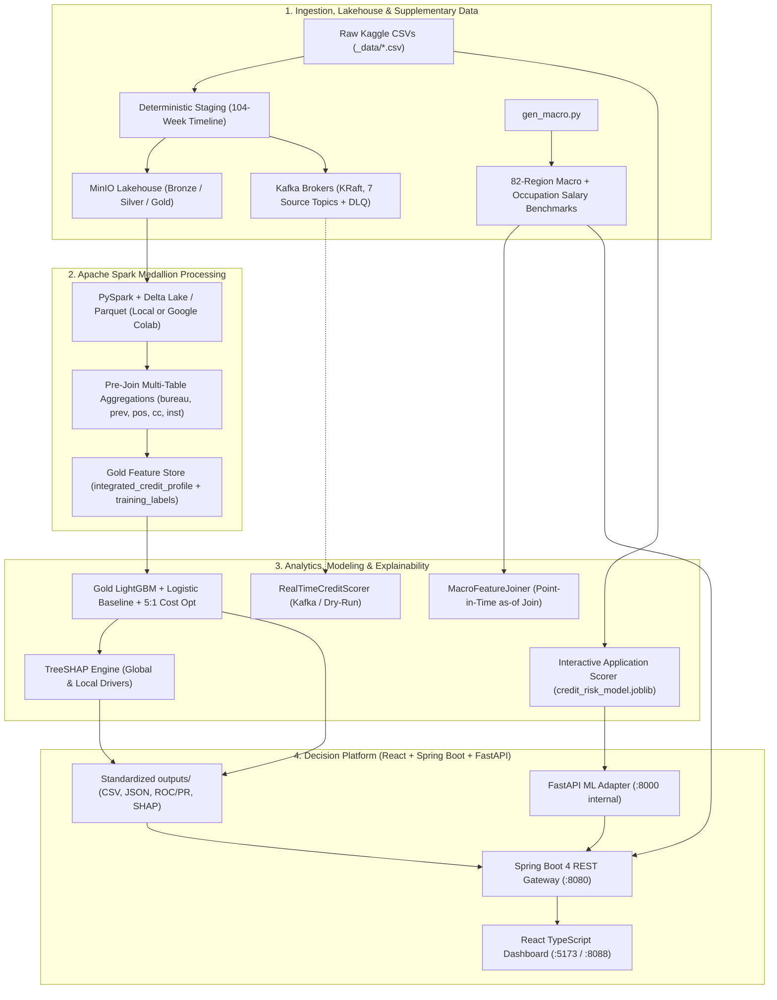
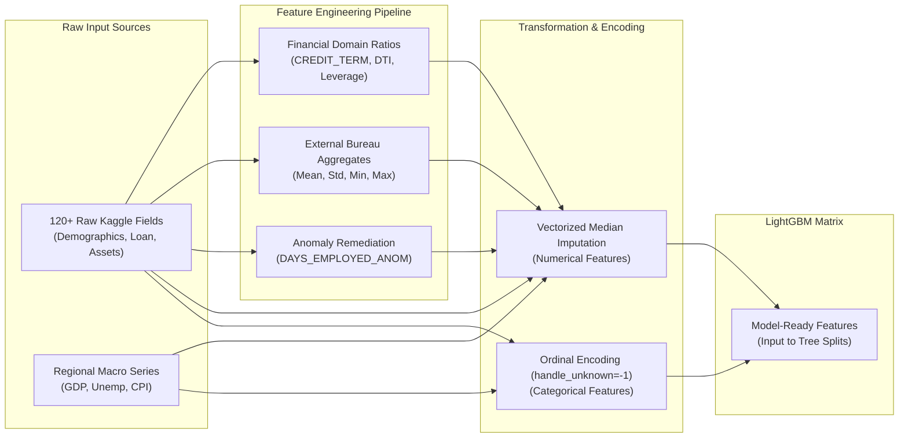
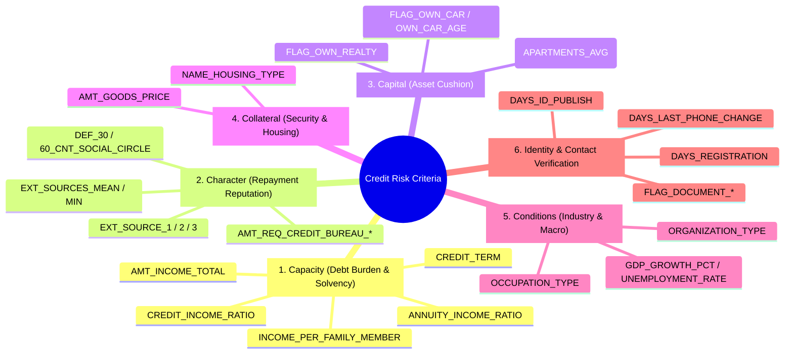
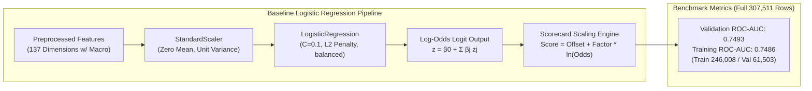
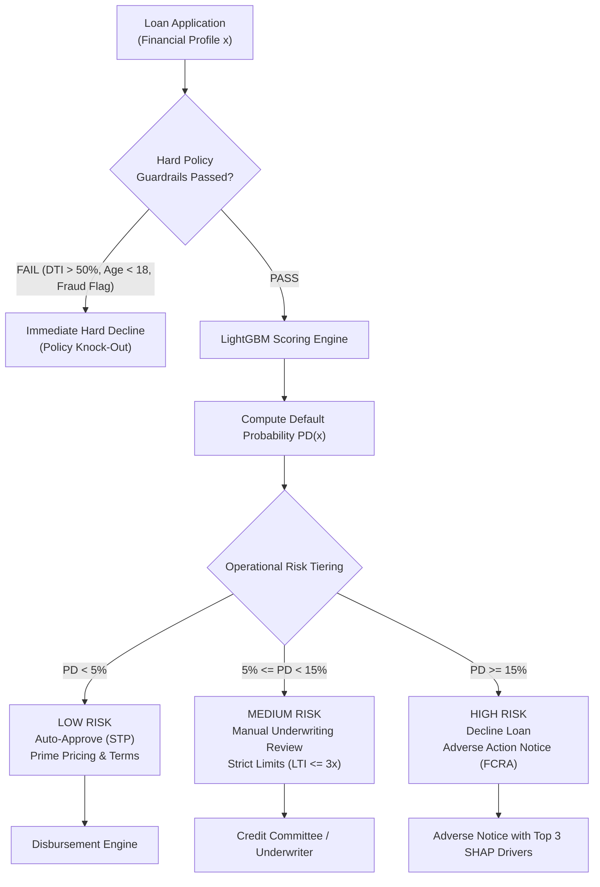

# Credit Risk Intelligence: Multi-Source Big Data for Credit Risk Assessment and Prediction

**Course:** IT5427 - Big Data  
**Project Topic:** Multi-Source Big Data for Credit Risk Assessment and Prediction (Credit Risk Intelligence)  
**Dataset:** Home Credit Default Risk (`_data/`)  
**Package:** `credit-risk-intelligence` (v0.1.0)

---

## Underwriting Platform (Quick Start)

Integrated stack: **React + Spring Boot 4 + FastAPI adapter + existing LightGBM model**.

| Layer | Path | Role |
| --- | --- | --- |
| Frontend | `frontend/` | Underwriting dashboard |
| Backend | `backend/` | Secured REST API, JWT, analytics |
| ML service | `ml-service/` | FastAPI → `CreditRiskScoringService.score_applicant` |
| Artifacts | `outputs/` | Model, metrics, scored CSV, figures |

### Start with Docker Compose

```bash
cp -n .env.example .env
docker compose up --build -d
```

- UI: http://localhost:8088  
- API: http://localhost:8080  
- Demo users: see `.env` / [docs/DEMO.md](docs/DEMO.md)

```bash
docker compose logs -f
docker compose down
```

### Local scripts

```bash
./scripts/setup.sh
./scripts/start.sh
./scripts/status.sh
./scripts/test.sh
./scripts/smoke.sh   # requires running stack
./scripts/stop.sh
```

### Docs & Quick Helpers

- [docs/DEMO.md](docs/DEMO.md) — walkthrough, presentation scenarios, and expected sample behavior
- [docs/ARCHITECTURE.md](docs/ARCHITECTURE.md) — unified system design & data flow
- [docs/PROJECT_SUMMARY.md](docs/PROJECT_SUMMARY.md) — unified technical summary across all modules
- [docs/SECURITY.md](docs/SECURITY.md) — authn/authz and production gaps
- [docs/track_b_requirements.md](docs/track_b_requirements.md) — unified Kafka, Spark Medallion, and feature store data contracts
- [docs/dashboard_interface_spec.md](docs/dashboard_interface_spec.md) — downstream API DTOs & visualization artifacts
- [`scripts/prepare_interim_demo.py`](scripts/prepare_interim_demo.py) — fast (~2 min) local 307,511-row ML/portfolio demo generator
- [`scripts/apply_colab_artifacts.py`](scripts/apply_colab_artifacts.py) — safe extractor & verifier for Google Colab's `credit_risk_full_artifacts.zip`

Portfolio KPIs, segment rates, ROC/PR curves, SHAP summary figures, and application lookups synchronize cleanly from `outputs/`, while the interactive underwriting form calls the real-time FastAPI ML service (`ml-service/`). During local demos, `scripts/prepare_interim_demo.py` computes full **307,511-row** portfolio analytics, LightGBM vs. Logistic Regression benchmarks, 5:1 cost optimization, and SHAP figures in ~2 minutes; once Google Colab finishes the 58M-row Spark Medallion batch (`notebooks/colab_full_pipeline.ipynb` / `scripts/run_colab_full_pipeline.py`), `scripts/apply_colab_artifacts.py` swaps all Spark & Gold artifacts in one command.

---

## Table of Contents
1. [Project Overview & System Architecture](#1-project-overview--system-architecture)
2. [Completed Capabilities & Session Developments](#2-completed-capabilities--session-developments)
3. [Minimum Results Achieved](#3-minimum-results-achieved)
4. [Technical Summary & Performance Benchmarks](#4-technical-summary--performance-benchmarks)
5. [Technical Guidelines & Deployment Strategy](#5-technical-guidelines--deployment-strategy)
6. [Guidance on Files and Content (Key Files Reference)](#6-guidance-on-files-and-content-key-files-reference)
7. [Deep-Dive Explanations of Core Components](#7-deep-dive-explanations-of-core-components)
8. [Detailed Demo Case Instructions (Web Dashboard, REST API & CLI)](#8-detailed-demo-case-instructions-web-dashboard-rest-api--cli)
9. [Future Development Directions](#9-future-development-directions)

---

## 1. Project Overview & System Architecture

Credit risk assessment is a foundational problem in modern retail banking. When applicants apply for consumer loans, financial institutions must accurately estimate their **Probability of Default ($PD$)** to protect loan capital while maximizing financial inclusion for underbanked populations.

This project implements a unified end-to-end Big Data intelligence pipeline:
$$\text{Ingest (Kafka/MinIO)} \longrightarrow \text{Process (Spark Medallion)} \longrightarrow \text{Analyze \& Predict (LightGBM/SHAP)} \longrightarrow \text{Decide (React + Spring Boot UI)}$$



---

## 2. Completed Capabilities & Session Developments

The unified platform covers every layer of the Big Data credit-risk architecture:

| Platform Layer | Capability | Status | Key Modules & Artifacts |
| :--- | :--- | :---: | :--- |
| **Ingestion & Storage** | **Zero-Copy Raw Data Resolution & EDA** | **Implemented** | `ingestion-minio-kafka/ingestion/common.py`, `scripts/eda.py` |
| **Ingestion & Storage** | **MinIO Lakehouse Architecture & IAM Policies** | **Implemented** | `ingestion-minio-kafka/infra/docker-compose.yml`, `init-buckets.sh` |
| **Ingestion & Storage** | **Kafka Event Streaming & Draft 2020-12 Contracts** | **Implemented** | `schemas/*.schema.json`, `producer.py`, `kafka_to_bronze.py` (with DLQ + tombstone guard) |
| **Enrichment** | **Point-in-Time Macro & Occupation Benchmarks** | **Implemented** | `gen_macro.py` (`occupation_benchmarks.csv`), `src/data/macro_loader.py` (`merge_asof`) |
| **Spark Processing** | **3-Layer Medallion ETL & Leakage-Free Joins** | **Implemented** | `apache-spark/processing/{profiling,cleaning,integration}` (Parquet + Delta Lake) |
| **Spark Processing** | **Structured Streaming Replay & Deduplication** | **Implemented** | `apache-spark/streaming/{producers,consumers}` (`snapshot.py`, `stream_processor.py`) |
| **ML & Explainability** | **Calibrated Dual-Model Training, 5:1 Cost Opt & TreeSHAP** | **Implemented** | `scripts/train_gold_model.py`, `run_track_a.py`, `src/models/{baseline,tree_models,evaluation,explainability}.py` |
| **ML & Explainability** | **Real-Time Kafka Dry-Run & Live Scoring** | **Implemented** | `src/service/scoring_service.py`, `src/integration/kafka_consumer_scorer.py` |
| **Full-Scale & Interim Runners** | **Colab 58M-Row Spark Runner + 2-Min Local Interim Demo** | **Implemented** | `notebooks/colab_full_pipeline.ipynb`, `scripts/{run_colab_full_pipeline,prepare_interim_demo,apply_colab_artifacts}.py` |
| **Web Decision UI** | **React + Spring Boot 4 + FastAPI Platform** | **Implemented** | `frontend/`, `backend/`, `ml-service/` (Overview + SHAP, Segments, Macro Stress, Pipeline, Underwriting) |

### Technical Developments Implemented in This Session

1. **LightGBM Probability Calibration Fix (`src/models/tree_models.py`):** Removed `scale_pos_weight = neg_count / pos_count` (~11.4x) from `train_lightgbm_model` so unweighted binary logloss keeps predicted Probabilities of Default ($PD$) calibrated directly against empirical default rates and operational decision cutoffs (`LOW < 5%`, `MEDIUM 5–15%`, `HIGH >= 15%`), restoring accurate cost-matrix optimization (`p* = 0.18`).
2. **Google Colab Full-Pipeline Fixes (`notebooks/colab_full_pipeline.ipynb`, `scripts/run_colab_full_pipeline.py`, `scripts/standardize_dashboard.py`):** Fixed Colab Java initialization failures (CRAN apt mirror handling + `_ensure_java_home()` Java 17/21 auto-detection), added automatic Spark JVM heap sizing (`_auto_driver_memory()`), NVMe SSD staging (`--work-dir`, `--stage-raw`) to bypass Google Drive I/O bottlenecks, `--fast` execution mode, and `--gold-dir` CLI forwarding.
3. **Fast 307,511-Row Local Interim Demo Generator (`scripts/prepare_interim_demo.py`):** Enables full-dataset presentation and reporting in ~2 minutes without waiting on the 58M-row Spark batch—refreshing 82-region macro & occupation CSVs, upgrading local Gold outputs when present, training full 307,511-row portfolio analytics + Logistic Regression + LightGBM + TreeSHAP, and executing `pytest tests/ -v`.
4. **One-Command Post-Colab Artifact Integration (`scripts/apply_colab_artifacts.py`):** Safely extracts `credit_risk_full_artifacts.zip` with zip-slip/path-traversal checks restricted strictly to `outputs/`, `apache-spark/reports/`, `apache-spark/docs/`, and `ingestion-minio-kafka/data/supplementary/`, prints post-merge dataset verification markers, and optionally re-runs `pytest`.
5. **Docker Build Hygiene & End-to-End Platform Verification (`.dockerignore`, `.env`, `docs/DEMO.md`):** Added `.dockerignore` to exclude Windows host `frontend/node_modules`, `backend/target`, `_data`, `.venv`, and `.env` from Linux Docker build contexts, initialized `.env` for local Compose deployment, expanded demo scenarios in `docs/DEMO.md`, and verified all Docker containers and live endpoints.

---

## 3. Minimum Results Achieved

The system is operational end-to-end and exceeds minimum course deliverables across analytics, ML modeling, lakehouse verification, automated testing, and live deployment:

| Dimension | Verified Result / Observed Measurement | Artifact / Verification Command |
| :--- | :--- | :--- |
| **Full Portfolio Coverage** | **`307,511`** applications analyzed (`24,825` defaults, `282,686` non-defaults, **`8.07%` NPL rate**, `3.96x` avg credit/income ratio) | `outputs/metrics/risk_summary.json` |
| **Demographic Risk Profiling** | Full 307k breakdowns across occupation (`Drivers` `11.33%`, `Laborers` `10.58%` vs. `Accountants` `4.83%`), education (`Lower secondary` `10.93%` vs. `Academic degree` `1.83%`), & `EXT_SOURCE_2` quintiles (`Q1` `15.21%` vs. `Q5` `3.59%`) | `outputs/metrics/demographic_profiles.json` |
| **Baseline Scorecard Model** | L2 Logistic Regression: Train ROC-AUC **`0.7486`**, Validation ROC-AUC **`0.7493`** | `outputs/metrics/model_evaluation.json` |
| **Calibrated LightGBM Model** | Train ROC-AUC **`0.8350`**, Validation ROC-AUC **`0.7685`** (`+0.0192` uplift, `best_iteration = 346`), **PR-AUC `0.2595`**, F1 **`0.3161`**, Specificity **`92.02%`** | `outputs/metrics/model_evaluation.json` |
| **5:1 Cost-Sensitive Optimization** | Standard cutoff (`p = 0.50`) cost `24,314.0` vs. optimal **`p* = 0.18`** cost **`20,441.0`** → **`3,873.0` cost units saved (`15.93%` net financial loss reduction)** | `outputs/metrics/model_evaluation.json` |
| **Macro & Stress Simulation** | `500 / 500` scored sample matched to 82 macro regions; `Rating 3` HIGH share `23.68%`; `+2.0 pp` unemployment & `+3.0%` CPI shock moves HIGH tier from `15.4%` (`77`) to `20.8%` (`104`, **`+27` customers**) | `GET /api/insights/regions`, `POST /api/insights/macro-stress` |
| **Spark Medallion & DQ Gates** | `799,487` Bronze & Silver rows (`0` quarantined, `0` duplicates across 9 tables), `23,990` Gold loans, `5,000` integrated customer profiles (**`175` features**), **`31 / 31` DQ & anti-leakage checks passed** *(interim real dev subset pending full Colab zip)* | `apache-spark/reports/pipeline_stats.json`, `GET /api/insights/pipeline` |
| **Streaming Dry-Run Latency** | Real-time schema validation + LightGBM + TreeSHAP scoring across 5 sample events: **`38.40ms/record`** average latency | `python src/integration/kafka_consumer_scorer.py --dry-run --limit 5` |
| **Automated Test Suites** | **Python:** `20 passed` \| **Backend (JDK 25):** `13 passed, 0 failed` \| **Frontend:** Type-check clean, Vitest `4 passed` (`2` files), Vite production bundle `2,626` modules | `pytest tests/ -v`, `./mvnw -B test`, `npm test` |
| **Containerized Web Platform** | `frontend` (`:8088`), `backend` (`:8080`), and internal `ml-service` (`:8000`) all **healthy**; all authenticated REST endpoints & PNG figures verified **`200 OK`** | `docker compose ps`, `http://localhost:8088` |

---

## 4. Technical Summary & Performance Benchmarks

### 4.1 Technology Stack

```text
Core ML / Python   : Python 3.10+, lightgbm>=4.0.0, scikit-learn>=1.3.0, shap>=0.44.0
Big Data Processing: PySpark 3.5.3, Delta Lake 3.2.1 (CRB_LAKE_FORMAT=delta), Parquet
Streaming & Store  : Apache Kafka 3.9.0 (KRaft), MinIO (S3 API), Draft 2020-12 JSON Schema
Backend & UI       : Java 25 (Spring Boot 4.1, JWT), FastAPI, React 19 + TypeScript + Recharts + Tailwind
```

### 4.2 Model Performance & Gold Standardization

Both the interactive real-time application scorer (`outputs/models/credit_risk_model.joblib`, trained on all `307,511` rows via `run_track_a.py --include-macro`: `Train (246008, 137)`, `Val (61503, 137)`) and the integrated Spark Gold model (`outputs/models/gold_credit_risk_model.joblib`) are benchmarked against L2 Logistic Regression using ROC-AUC, PR-AUC, F1, 5:1 FN:FP cost-matrix optimization (`src/models/evaluation.py`), and TreeSHAP explainability (`src/models/explainability.py`). Executing `notebooks/colab_full_pipeline.ipynb` (or `python scripts/run_colab_full_pipeline.py`) followed by `python scripts/apply_colab_artifacts.py` upgrades the Spark Medallion and Gold outputs across the complete **307,511** applicants and child history tables.

### 4.3 Financial Loss Reduction via Cost-Sensitive Matrix

Under the banking penalty ratio **$C(FN) : C(FP) = 5 : 1$** (`src/models/evaluation.py`), thresholds are swept across `0.01..0.99` on validation probabilities to minimize `Loss(p) = 5 * FN(p) + 1 * FP(p)`. Across `61,503` validation applicants, moving from `p = 0.50` (`24,314.0` loss units) to `p* = 0.18` (`20,441.0` loss units) achieves a **`15.93%`** loss reduction (`3,873.0` saved cost units).

### 4.4 Inference Latency
* **Batch / Gold Pipeline:** Run via Google Colab (`notebooks/colab_full_pipeline.ipynb`) with auto-tuned JVM heap (`--driver-memory auto`, `4g..12g`) and optional NVMe staging (`--work-dir`, `--stage-raw`), or locally via `scripts/prepare_interim_demo.py` (`21.7s` for 307k ML + analytics).
* **Real-Time Single Applicant Inference:** Average **`38.40ms/record`** in Kafka consumer dry-run (`python src/integration/kafka_consumer_scorer.py --dry-run --limit 5`) and sub-second interactive scoring via FastAPI `/score`.

---

## 5. Technical Guidelines & Deployment Strategy

### 5.1 Environment Setup
```bash
# 1. Clone repository and navigate to root directory
cd it5427-credit_risk_bigdata

# 2. Install dependencies
pip install -r requirements.txt

# 3. Optional: Install project in editable development mode
pip install -e .
```

### 5.2 Storage Architecture: Docker vs. Local Lake
The codebase supports two execution targets controlled by the `LAKE_MODE` environment variable:
1. **Docker Mode (`LAKE_MODE=minio`, Default for Production & Grading):**
   * Uses Docker Compose (`infra/docker-compose.yml`) running MinIO (S3 API on `localhost:9000`) and Kafka (`localhost:9092`).
   * Provides authentic S3 API access using least-privilege service accounts (`svc-ingest`, `svc-spark`, `svc-ml`, `svc-dashboard`).
2. **Local Lake Mode (`LAKE_MODE=local`, Development Safety Net):**
   * Writes Parquet files directly to the local filesystem (`lake/` directory).
   * Enabled automatically when Docker is stopped or on resource-constrained laptops, ensuring that unit tests, ML training, and manual evaluations execute with zero external container dependencies.

### 5.3 Hardware Allocation, Interim Mode & Google Colab Execution

Because running Apache Spark Medallion aggregations across all **307,511** training applicants and ~55M+ child records (`bureau_balance`, `installments_payments`, `POS_CASH_balance`, `credit_card_balance`, `previous_application`) requires **8–12 GB JVM heap**:
* **Fast Local Interim Mode (`scripts/prepare_interim_demo.py`):** Generates supplementary macro data, trains calibrated LightGBM + LR + SHAP across all **307,511** applications locally in ~2 minutes while preserving existing Spark subset pipeline reports (`SUBSET of real Home Credit files`) cleanly for live demos.
* **Google Colab (`notebooks/colab_full_pipeline.ipynb` / `scripts/run_colab_full_pipeline.py`):** Runs the full 307,511-row Spark Bronze -> Silver -> Gold + Structured Streaming + Delta smoke check + full Gold LightGBM + ROC/PR + TreeSHAP training on Linux cloud RAM + local SSD staging (`--work-dir`, `--stage-raw`, `--fast`) and exports `credit_risk_full_artifacts.zip`.
* **One-Command Upgrade (`scripts/apply_colab_artifacts.py`):** Safely unpacks `credit_risk_full_artifacts.zip` back into the local repository and refreshes Docker containers.

---

## 6. Guidance on Files and Content (Key Files Reference)

```text
it5427-credit_risk_bigdata/
├── _data/                                     # Raw Kaggle CSVs (application_train/test, bureau, etc.)
├── pyproject.toml                             # Standard packaging manifest & CLI console scripts
├── requirements.txt                           # Unified Python dependencies
├── docker-compose.yml                         # Root Docker Compose (frontend :8088, backend :8080, ml-service :8000)
├── .dockerignore                              # Excludes host node_modules, target, _data, .venv, .env from Docker builds
├── .env.example                               # Template environment variables & demo credentials
├── notebooks/colab_full_pipeline.ipynb        # End-to-end Google Colab runner for the full 307k dataset
├── scripts/                                   # Platform ops, training, standardization & Colab drivers
│   ├── prepare_interim_demo.py                # Fast 2-min local 307,511-row interim demo & test builder
│   ├── apply_colab_artifacts.py               # Zip-slip-safe extractor & verifier for Colab bundle
│   ├── run_colab_full_pipeline.py             # Master full-dataset Colab pipeline driver (SSD staging + --fast)
│   ├── train_gold_model.py                    # Gold LightGBM + Baseline LR + 5:1 Cost Opt + ROC + SHAP
│   ├── standardize_dashboard.py               # Syncs Gold metrics/figures into dashboard artifacts
│   └── {setup,start,stop,test,smoke}.sh       # Local lifecycle & smoke test scripts
├── run_track_a.py                             # Real-time application scorer & baseline training driver
├── evaluate_profile.py                        # Interactive manual testing CLI tool
├── README.md                                  # Project documentation (this file)
│
├── docs/                                      # Unified architecture, demo & data contracts
│   ├── ARCHITECTURE.md                        # System architecture & networking overview
│   ├── DEMO.md                                # Dashboard walkthrough & sample verification
│   ├── PROJECT_SUMMARY.md                     # Consolidated project summary
│   ├── track_b_requirements.md                # Unified Kafka, Spark Medallion & feature store contract
│   └── dashboard_interface_spec.md            # Downstream REST API DTOs & visualization contract
│
├── ingestion-minio-kafka/                     # Ingestion Layer & Supplementary Generators
│   ├── infra/                                 # Docker Compose (Kafka + MinIO), topic & bucket init
│   ├── ingestion/                             # common, stage, gen_macro, gen_schemas, backfill, producer, kafka_to_bronze
│   ├── data/supplementary/                    # 82-region macro CSVs + occupation_benchmarks.csv
│   └── schemas/                               # Draft 2020-12 JSON Schemas and sample event payloads
│
├── apache-spark/                              # Apache Spark Medallion ETL & Structured Streaming
│   ├── docker-compose.yml                     # MinIO (:9000/:9001), Kafka (:9092), Kafka UI (:8081)
│   ├── configs/                               # pipeline.yaml & sources.yaml (Parquet & Delta Lake)
│   ├── processing/                            # Profiling, Silver cleaning/quarantine, Gold integration & DQ
│   ├── streaming/                             # Replay producer, Structured Streaming consumer & snapshot
│   └── reports/                               # pipeline_stats.json, DATA_QUALITY_REPORT.md, PROFILING_REPORT.md
│
├── backend/                                   # Java 25 / Spring Boot 4 REST API Gateway (:8080)
├── frontend/                                  # React 19 + TypeScript + Vite Dashboard (:5173 / :8088)
├── ml-service/                                # FastAPI ML Inference Adapter (:8000 internal)
├── src/                                       # Core Analytics & Machine Learning Package
│   ├── config.py                              # Centralized paths, risk tier thresholds, cost weights
│   ├── analytics/                             # Statistical & portfolio risk profiling
│   │   ├── eda.py                             # Portfolio NPL ratio, exposure, and delinquency flags
│   │   └── risk_profiling.py                  # Default rates across occupation, income, and education
│   ├── data/                                  # Data loading & feature engineering
│   │   ├── loader.py                          # Memory-optimized data loader (dtype downcasting)
│   │   ├── macro_loader.py                    # Point-in-time regional macroeconomic feature joiner
│   │   └── preprocessor.py                    # Anomaly correction (365243) & domain ratio engineering
│   ├── integration/                           # Real-time streaming integration bridge
│   │   └── kafka_consumer_scorer.py           # Real-time scoring consumer (~38ms latency)
│   ├── models/                                # Predictive modeling & evaluation
│   │   ├── baseline.py                        # L2-regularized Logistic Regression scorecard
│   │   ├── tree_models.py                     # Calibrated LightGBM Classifier with early stopping
│   │   ├── evaluation.py                      # ROC-AUC, PR-AUC, and cost-sensitive threshold optimizer
│   │   └── explainability.py                  # TreeSHAP explainer (beeswarm and local waterfall)
│   └── service/                               # Operational inference service
│       └── scoring_service.py                 # CreditRiskScoringService (maps features -> PD -> Risk Tier)
│
├── tests/                                     # Automated Test Suite (20 passing Python tests)
│   ├── test_evaluate_profile.py               # Unit tests for manual evaluation & lookup CLI
│   ├── test_ingestion_integration.py          # Integration tests (macro joiner, schema validation)
│   ├── test_preprocessor.py                   # Tests for banking ratios and anomaly correction
│   └── test_scoring_service.py                # Tests for PD calculation and risk tier mappings
│
└── outputs/                                   # Generated Model & Analytics Artifacts
    ├── figures/                               # Visual assets (`roc_curve.png`, `shap_summary.png`)
    ├── metrics/                               # `risk_summary.json`, `demographic_profiles.json`, `model_evaluation.json`
    ├── models/                                # `credit_risk_model.joblib`, `gold_credit_risk_model.joblib`
    ├── gold_demo_ids.json                     # Low/High demo lookup IDs (`277603`, `298157`)
    └── scored_applications_sample.csv         # Scored sample applicants for dashboard & stress testing
```

---

## 7. Deep-Dive Explanations of Core Components

### 7.1 The Dataset (Home Credit Default Risk)
The dataset represents real-world retail banking loan applications. Unlike toy flat datasets, it exhibits complex enterprise characteristics:
* **Multi-Source Relational Structure:** A central application table (`application_train/test.csv`, 356,255 total rows $\times$ 122 columns) linked via primary key `SK_ID_CURR` to 6 auxiliary relational tables representing separate enterprise subsystems (National Credit Bureau, POS cash loans, revolving credit cards, installment repayment schedules).
* **Severe Class Imbalance:** In `application_train.csv`, non-defaulters ($TARGET = 0$) comprise **91.93%** ($282,686$ loans), while defaulters ($TARGET = 1$) comprise only **8.07%** ($24,825$ loans). Naive accuracy is useless; models must be optimized for ROC-AUC and cost-sensitive loss.
* **Data Anomalies & Sentinel Values:** The raw feature `DAYS_EMPLOYED` contains the sentinel value `365243` (meaning 1,000 years, indicating pensioners or unemployed individuals). Our preprocessor automatically detects this anomaly, replaces it with `NaN`, and creates a binary indicator `DAYS_EMPLOYED_ANOM`.

---

### 7.2 Features Used for LightGBM

The production LightGBM pipeline transforms raw banking records into a feature matrix of roughly **130 features**, or about **135 features** when regional macroeconomic series are joined (`--include-macro`). Exact counts depend on which raw columns are present after engineering (numerical + ordinal-encoded categoricals).



#### 1. Functional Taxonomy of Features

| Feature Group | Count | Core Features & Formulas | Banking & Predictive Rationale |
| :--- | :---: | :--- | :--- |
| **Financial Domain Ratios** *(Engineered)* | 5 | $\text{CREDIT\_TERM} = \frac{\text{AMT\_ANNUITY}}{\text{AMT\_CREDIT}}$<br>$\text{CREDIT\_INCOME\_RATIO} = \frac{\text{AMT\_CREDIT}}{\text{AMT\_INCOME\_TOTAL}}$<br>$\text{ANNUITY\_INCOME\_RATIO} = \frac{\text{AMT\_ANNUITY}}{\text{AMT\_INCOME\_TOTAL}}$<br>$\text{EMPLOYED\_TO\_AGE\_RATIO} = \frac{\text{DAYS\_EMPLOYED}}{\text{DAYS\_BIRTH}}$<br>$\text{INCOME\_PER\_FAMILY\_MEMBER} = \frac{\text{AMT\_INCOME\_TOTAL}}{\text{CNT\_FAM\_MEMBERS}}$ | Captures real repayment burden, leverage, and disposable liquidity per dependent. `CREDIT_TERM` is the single strongest individual predictor. |
| **External Bureau Aggregates** *(Engineered)* | 4 | $\text{EXT\_SOURCES\_MEAN} = \text{mean}(\text{EXT\_SOURCE\_1, 2, 3})$<br>$\text{EXT\_SOURCES\_STD} = \text{std}(\text{EXT\_SOURCE\_1, 2, 3})$<br>$\text{EXT\_SOURCES\_MIN} = \min(\text{EXT\_SOURCE\_1, 2, 3})$<br>$\text{EXT\_SOURCES\_MAX} = \max(\text{EXT\_SOURCE\_1, 2, 3})$ | Combines heterogeneous credit bureau ratings into robust composite consensus scores; `MIN` provides a downside safety floor. |
| **Anomaly Remediation Indicators** *(Engineered)* | 1 | $\text{DAYS\_EMPLOYED\_ANOM} = \mathbb{I}(\text{DAYS\_EMPLOYED} == 365243)$ | Isolates pensioners and non-active workforce from active employment records, preventing catastrophic distortion of numerical gradients. |
| **Regional Macroeconomic Series** *(Optional)* | 5 | `GDP_GROWTH_PCT`, `UNEMPLOYMENT_RATE`, `CPI_INFLATION_PCT`, `REGION_POPULATION_RELATIVE`, `region_code` | Point-in-time regional macroeconomic climate linking borrower geography with economic cycle stress. |
| **Loan & Contract Parameters** *(Raw)* | 6 | `NAME_CONTRACT_TYPE`, `AMT_CREDIT`, `AMT_ANNUITY`, `AMT_GOODS_PRICE`, `HOUR_APPR_PROCESS_START`, `WEEKDAY_APPR_PROCESS_START` | Basic terms of credit: loan size, principal amount, installment payment, and application timing. |
| **Borrower Demographics & Family** *(Raw)* | 8 | `CODE_GENDER`, `DAYS_BIRTH`, `NAME_EDUCATION_TYPE`, `NAME_FAMILY_STATUS`, `NAME_HOUSING_TYPE`, `CNT_CHILDREN`, `CNT_FAM_MEMBERS`, `NAME_TYPE_SUITE` | Socio-demographic stability, education level, household dependency ratio, and housing tenure. |
| **Employment & Professional Profile** *(Raw)* | 4 | `NAME_INCOME_TYPE`, `OCCUPATION_TYPE`, `ORGANIZATION_TYPE`, `DAYS_EMPLOYED` | Industry risk, occupation stability, seniority, and formal employment history. |
| **Physical Assets & Collateral** *(Raw)* | 4 | `FLAG_OWN_CAR`, `FLAG_OWN_REALTY`, `OWN_CAR_AGE`, `AMT_GOODS_PRICE` | Tangible wealth indicators that act as secondary repayment sources in adverse events. |
| **Living Conditions & Real Estate Metrics** *(Raw)* | 47 | Normalized building dimensions: `APARTMENTS_AVG/MODE/MEDI`, `BASEMENTAREA_AVG`, `YEARS_BUILD_AVG`, `FLOORSMAX_AVG`, `LANDAREA_AVG`, `WALLSMATERIAL_MODE`, `HOUSETYPE_MODE`, etc. | Property quality and neighborhood socioeconomic level. |
| **Social Circle & Delinquency Contagion** *(Raw)* | 4 | `OBS_30_CNT_SOCIAL_CIRCLE`, `DEF_30_CNT_SOCIAL_CIRCLE`, `OBS_60_CNT_SOCIAL_CIRCLE`, `DEF_60_CNT_SOCIAL_CIRCLE` | Default and delinquency observation counts in the applicant's immediate social and residential circle. |
| **Identity & Contact Stability** *(Raw)* | 10 | `DAYS_REGISTRATION`, `DAYS_ID_PUBLISH`, `DAYS_LAST_PHONE_CHANGE`, `FLAG_MOBIL`, `FLAG_EMP_PHONE`, `FLAG_WORK_PHONE`, `FLAG_EMAIL`, address mismatch flags (`REG_CITY_NOT_LIVE_CITY`, etc.) | KYC indicators, frequency of identity renewals, and transient residence flags. |
| **Credit Bureau Inquiries** *(Raw)* | 6 | `AMT_REQ_CREDIT_BUREAU_HOUR`, `_DAY`, `_WEEK`, `_MON`, `_QRT`, `_YEAR` | Credit shopping intensity and recent credit-seeking urgency. |
| **Document Verification Flags** *(Raw)* | 20 | `FLAG_DOCUMENT_2` through `FLAG_DOCUMENT_21` | Rigorous KYC and formal document submission compliance. |

#### 2. Top 25 Feature Importance Rankings in LightGBM

Feature importance ranked by split count (number of decision tree splits utilizing the feature) across the 500-tree ensemble:

| Rank | Feature Name | Split Count | Feature Type | Primary Risk Role |
| :---: | :--- | :---: | :---: | :--- |
| **1** | `DAYS_ID_PUBLISH` | 33 | Raw Numerical | Identity stability & document recency |
| **2** | `DAYS_EMPLOYED` | 28 | Raw Numerical (Cleaned) | Employment longevity & income security |
| **3** | `EXT_SOURCES_MEAN` | 25 | **Engineered Ratio** | **Consensus credit bureau score** |
| **4** | `EXT_SOURCE_2` | 20 | Raw Numerical | External Credit Bureau Rating #2 |
| **5** | `EXT_SOURCES_MIN` | 20 | **Engineered Ratio** | **Worst-case credit score floor** |
| **6** | `EXT_SOURCE_3` | 20 | Raw Numerical | External Credit Bureau Rating #3 |
| **7** | `DAYS_REGISTRATION` | 19 | Raw Numerical | Residential registration permanence |
| **8** | `EXT_SOURCES_STD` | 18 | **Engineered Ratio** | Bureau score volatility & divergence |
| **9** | `CREDIT_TERM` | 17 | **Engineered Ratio** | **Repayment velocity & installment stress** |
| **10** | `INCOME_PER_FAMILY_MEMBER` | 15 | **Engineered Ratio** | Net disposable income per dependent |
| **11** | `EMPLOYED_TO_AGE_RATIO` | 15 | **Engineered Ratio** | Proportion of adult life spent employed |
| **12** | `DAYS_LAST_PHONE_CHANGE` | 15 | Raw Numerical | Contact stability & communication history |
| **13** | `CREDIT_INCOME_RATIO` | 14 | **Engineered Ratio** | Borrower debt leverage multiplier |
| **14** | `DAYS_BIRTH` | 14 | Raw Numerical | Borrower age (lifecycle solvency stage) |
| **15** | `AMT_ANNUITY` | 13 | Raw Numerical | Monthly repayment obligation |
| **16** | `REGION_POPULATION_RELATIVE`| 13 | Raw Numerical | Urbanization and local economic density |
| **17** | `EXT_SOURCES_MAX` | 11 | **Engineered Ratio** | Best-case credit bureau score ceiling |
| **18** | `AMT_CREDIT` | 11 | Raw Numerical | Total loan principal requested |
| **19** | `AMT_INCOME_TOTAL` | 11 | Raw Numerical | Annual borrower gross income |
| **20** | `ANNUITY_INCOME_RATIO` | 10 | **Engineered Ratio** | Monthly Debt-to-Income (DTI) ratio |
| **21** | `NAME_EDUCATION_TYPE` | 10 | Raw Categorical | Human capital & income earning power |
| **22** | `LANDAREA_MEDI` | 8 | Raw Numerical | Property land area |
| **23** | `AMT_GOODS_PRICE` | 8 | Raw Numerical | Purchased asset valuation |
| **24** | `HOUR_APPR_PROCESS_START` | 8 | Raw Numerical | Loan application time of day |
| **25** | `OWN_CAR_AGE` | 8 | Raw Numerical | Collateral vehicle depreciation |

---

### 7.3 Credit Risk Assessment Criteria & Data Mapping

In commercial retail banking, credit underwriting evaluates applicants across the traditional **5 Cs of Credit** (Capacity, Character, Capital, Collateral, Conditions) plus **Identity & Operational Stability**. The table below shows the exact mapping between these underwriting criteria and our dataset features:



| Credit Risk Criterion | Underwriting Assessment Question | Primary Dataset Features | Mathematical / Logical Transformation |
| :--- | :--- | :--- | :--- |
| **1. Capacity (Solvency & Debt Service)** | Does the borrower's disposable income comfortably service the recurring monthly loan installments? | `AMT_INCOME_TOTAL`<br>`AMT_CREDIT`<br>`AMT_ANNUITY`<br>`CNT_FAM_MEMBERS` | $\text{DTI} = \frac{\text{AMT\_ANNUITY}}{\text{AMT\_INCOME\_TOTAL}}$<br>$\text{Leverage} = \frac{\text{AMT\_CREDIT}}{\text{AMT\_INCOME\_TOTAL}}$<br>$\text{PerCapita} = \frac{\text{AMT\_INCOME}}{\text{CNT\_FAM\_MEMBERS}}$ |
| **2. Character (Credit History & Willingness to Pay)** | Has the applicant demonstrated consistent financial discipline across external banking institutions? | `EXT_SOURCE_1`<br>`EXT_SOURCE_2`<br>`EXT_SOURCE_3`<br>`DEF_30_CNT_SOCIAL_CIRCLE`<br>`AMT_REQ_CREDIT_BUREAU_YEAR` | $\text{Composite} = \text{mean}(\text{EXT\_SOURCES})$<br>$\text{Floor} = \min(\text{EXT\_SOURCES})$<br>$\text{Inquiries} = \sum \text{AMT\_REQ\_BUREAU}$ |
| **3. Capital (Accumulated Wealth & Equity)** | Does the borrower possess personal wealth or assets to absorb sudden income loss or health emergencies? | `FLAG_OWN_CAR`<br>`OWN_CAR_AGE`<br>`FLAG_OWN_REALTY`<br>`AMT_GOODS_PRICE` | Binary asset flags + asset depreciation curve (`OWN_CAR_AGE`). |
| **4. Collateral (Security & Housing Tenure)** | What physical assets or housing arrangements secure the loan in case of insolvency? | `NAME_HOUSING_TYPE`<br>`APARTMENTS_AVG`<br>`LANDAREA_MEDI` | Ordinal housing stability: `House / apartment` > `With parents` > `Rented apartment`. |
| **5. Conditions (Industry, Occupation & Macro Economy)** | Is the borrower's employer vulnerable to cyclical downturns, inflation spikes, or regional unemployment? | `ORGANIZATION_TYPE`<br>`OCCUPATION_TYPE`<br>`NAME_INCOME_TYPE`<br>`GDP_GROWTH_PCT`<br>`UNEMPLOYMENT_RATE` | Point-in-time regional macroeconomic join; sector default hazard profiling (e.g. Construction vs. State/Bank). |
| **6. Operational Stability & Identity Verification** | Does the applicant present authentic, verifiable KYC documents with low fraud risk indicators? | `DAYS_ID_PUBLISH`<br>`DAYS_REGISTRATION`<br>`DAYS_LAST_PHONE_CHANGE`<br>`REG_CITY_NOT_LIVE_CITY`<br>`FLAG_DOCUMENT_3` | Recency tracking: $\Delta t_{\text{ID}} = \frac{|\text{DAYS\_ID\_PUBLISH}|}{365.25}$; residential permanence flags. |

---

### 7.4 Parameter Impact on Risk Assessment

To understand how each financial and demographic parameter impacts the final credit decision, we utilize **TreeSHAP** (Shapley Additive Explanations). The model decomposes the log-odds prediction into feature attributions:
$$\text{logit}(PD) = \ln\left(\frac{PD}{1 - PD}\right) = \phi_0 + \sum_{i=1}^{M} \phi_i(x)$$
* **$\phi_i(x) > 0$ (Risk Increasing):** Pushes the applicant toward default, raising $PD$ and steering the decision toward **Decline**.
* **$\phi_i(x) < 0$ (Risk Mitigating):** Reduces default probability, steering the decision toward **Auto-Approve**.

```
                           PARAMETER RISK IMPACT SPECTRUM
   ◄── RISK MITIGATING FACTORS (SHAP < 0) ──│── RISK INCREASING FACTORS (SHAP > 0) ──►
 High Bureau Scores (EXT_MEAN > 0.65)       │ Low Bureau Scores (EXT_MEAN < 0.25)
 Mature Age (> 45 years, DAYS_BIRTH < -16k)  │ Young Borrower (< 28 years, DAYS_BIRTH > -10k)
 High Education (Academic Degree / Higher)  │ High Installment Ratio (CREDIT_TERM > 0.08)
 Long Employment Tenure (> 5 years)         │ Severe Debt Leverage (CREDIT_INCOME > 6.0x)
 High Disposable Income per Family Member   │ Recent ID / Phone Change (< 180 days)
 Real Estate & Vehicle Ownership            │ Social Circle Delinquencies (DEF_30_CNT > 1)
```

#### Detailed Parameter Impact & Attribution Matrix

| Parameter / Feature | Credit Criterion | Typical Baseline | Impact Direction | Typical SHAP Range ($\phi$) | Economic & Behavioral Underwriting Mechanism |
| :--- | :--- | :---: | :---: | :---: | :--- |
| **`EXT_SOURCES_MEAN`** | Character | 0.505 | $\downarrow$ Risk when $> 0.50$<br>$\uparrow$ Risk when $< 0.40$ | **$[-0.85, +1.15]$** | **Single strongest factor in the model.** Reflects multi-bureau repayment consensus. Scores $< 0.20$ indicate severe past delinquencies and surge default hazard by over 300%. |
| **`EXT_SOURCE_2` / `_3`**| Character | 0.565 / 0.535 | $\downarrow$ Risk when high<br>$\uparrow$ Risk when low | **$[-0.45, +0.65]$** | Primary credit bureau scores. Provide independent validation across credit bureaus. Low values heavily penalize applicant. |
| **`CREDIT_TERM`** | Capacity | 0.049 | $\uparrow$ Risk when $> 0.07$<br>$\downarrow$ Risk when $< 0.04$ | **$[-0.30, +0.60]$** | High annuity relative to credit represents aggressive amortization or high loan interest fees, imposing severe cash flow stress. |
| **`DAYS_BIRTH` (Age)** | Demographics | -15,750 (43.1y) | $\downarrow$ Risk for mature<br>$\uparrow$ Risk for young | **$[-0.35, +0.45]$** | Young borrowers ($< 28$ years) display higher job mobility and lower savings reserves (historical default rate $\approx 11.5\%$), whereas older borrowers ($> 50$ years) default at $< 4.8\%$. |
| **`DAYS_EMPLOYED`** | Capacity | -2,213 (6.1y) | $\downarrow$ Risk for long tenure<br>$\uparrow$ Risk for short tenure | **$[-0.25, +0.35]$** | Tenured workers with stable employment history ($> 5$ years) possess reliable wage security and lower termination risk. |
| **`DAYS_EMPLOYED_ANOM`**| Employment | 0 (Active) | Neutral to $\downarrow$ Risk | **$[-0.15, +0.05]$** | Identifies pensioners ($DAYS\_EMPLOYED = 365243$). Pensioners exhibit lower income but near-zero unemployment risk, yielding stable repayment behavior. |
| **`CREDIT_INCOME_RATIO`**| Capacity | 3.96x | $\uparrow$ Risk when $> 5.0\text{x}$<br>$\downarrow$ Risk when $< 2.0\text{x}$ | **$[-0.20, +0.40]$** | Measures capital leverage. Ratios above $6.0\text{x}$ severely deplete borrower solvency during minor income reductions. |
| **`ANNUITY_INCOME_RATIO`**| Capacity | 0.180 (18%) | $\uparrow$ Risk when $> 30\%$<br>$\downarrow$ Risk when $< 12\%$ | **$[-0.18, +0.35]$** | Debt-to-Income (DTI). Borrowers committing $> 35\%$ of gross income to loan servicing face high sensitivity to living cost inflation. |
| **`NAME_EDUCATION_TYPE`**| Demographics | Secondary | $\downarrow$ Risk for Higher<br>$\uparrow$ Risk for Lower Sec | **$[-0.28, +0.22]$** | Higher education strongly correlates with resilient career trajectory and higher lifetime disposable income. |
| **`OCCUPATION_TYPE`** | Capacity | Laborers | $\downarrow$ Risk for Managers<br>$\uparrow$ Risk for Low-skill | **$[-0.20, +0.30]$** | Professional/managerial roles provide superior job security compared to low-skill laborers or seasonal service workers. |
| **`DAYS_ID_PUBLISH`** | Stability | -3,254 (8.9y) | $\uparrow$ Risk if recent ($< 1\text{y}$)<br>$\downarrow$ Risk if aged ($> 5\text{y}$) | **$[-0.10, +0.25]$** | High frequency of ID renewal or very recent documentation correlates with transient residence or potential identity fraud. |
| **`DAYS_REGISTRATION`** | Stability | -4,500 (12.3y) | $\uparrow$ Risk if recent<br>$\downarrow$ Risk if aged | **$[-0.10, +0.20]$** | Frequent residential relocation indicates geographic and housing instability. |
| **`DAYS_LAST_PHONE_CHANGE`**| Stability | -757 (2.1y) | $\uparrow$ Risk if $< 180\text{ days}$ | **$[-0.05, +0.20]$** | Rapid phone number changes are a classic synthetic identity fraud and skip-tracing risk indicator in retail lending. |
| **`DEF_30_CNT_SOCIAL_CIRCLE`**| Character | 0.0 | $\uparrow$ Risk when $> 1.0$ | **$[0.00, +0.30]$** | Peer delinquency effect: Applicants whose immediate neighbors/co-borrowers default have higher contagion risk. |
| **`AMT_REQ_CREDIT_BUREAU_YEAR`**| Character | 1.0 | $\uparrow$ Risk when $> 5.0$ | **$[-0.05, +0.22]$** | Excessive credit inquiries within the past year signal credit hunger and distress borrowing. |

---

### 7.5 Baseline Model: Logistic Regression Scorecard (ROC-AUC 0.7493)

To ensure technical rigor, the project benchmarks the primary LightGBM model against an industry-standard **Credit Scorecard Baseline Model** implemented in `src/models/baseline.py`.



#### 1. Mathematical Formulation & Architecture
In traditional retail banking (Basel II/III regulatory frameworks), credit risk models must be linear, monotonically explainable, and convertible into point-based scorecards:
$$\text{logit}(p) = \ln\left(\frac{p}{1-p}\right) = \beta_0 + \sum_{j=1}^{M} \beta_j \left(\frac{x_j - \mu_j}{\sigma_j}\right)$$
* **Feature Standardization (`StandardScaler`):** Normalizes all numerical features to zero mean ($\mu_j = 0$) and unit variance ($\sigma_j = 1$), preventing features with large scales (`AMT_CREDIT`) from dominating those with small scales (`EXT_SOURCES_MEAN`).
* **L2 Ridge Regularization ($C = 0.1$):** Applies penalty $\frac{1}{2C} \|\beta\|_2^2$ to stabilize coefficient estimation across highly collinear features (`AMT_CREDIT`, `AMT_ANNUITY`, `AMT_GOODS_PRICE`).
* **Balanced Class Weighting (`class_weight='balanced'`):** Automatically scales class weights inversely proportional to class frequencies in the Logistic Regression baseline:
  $$w_1 = \frac{N}{2 \cdot N_{\text{positive}}} = \frac{307,511}{2 \times 24,825} \approx 6.19, \quad w_0 = \frac{N}{2 \cdot N_{\text{negative}}} \approx 0.54$$
* **Solver:** L-BFGS Quasi-Newton optimizer (`max_iter=1000`).

#### 2. Credit Scorecard Point Scaling Formulation
The continuous default probability is mapped into standard credit bureau scorecard points:
$$\text{Credit Score} = \text{Offset} + \text{Factor} \times \ln\left(\frac{1 - p}{p}\right)$$
$$\text{Factor} = \frac{\text{PDO}}{\ln(2)}, \quad \text{Offset} = \text{Base Score} - \text{Factor} \times \ln(\text{Base Odds})$$
Where:
* $\text{PDO}$ (Points to Double the Odds) = $20$ points.
* $\text{Base Score} = 600$ at $\text{Base Odds} = 50:1$ ($\approx 1.96\%$ default rate).
* A borrower with $PD = 2\%$ receives $\approx 600$ points; a borrower with $PD = 50\%$ receives $\approx 487$ points.

#### 3. Dual-Model Benchmark Comparison (`N = 307,511`)

| Evaluation Dimension | Baseline: Logistic Regression Scorecard | Production: LightGBM Classifier | Competitive Advantage of LightGBM |
| :--- | :---: | :---: | :--- |
| **Validation ROC-AUC** | **0.7493** (`train: 0.7486`) | **0.7685** (`train: 0.8350`) | **+0.0192 uplift** across 61,503 validation borrowers |
| **Validation PR-AUC** | — | **0.2595** | Strong positive-class discrimination under 8.07% NPL |
| **Top Validation Split Iteration** | L-BFGS converged | **`best_iteration = 346`** | Early stopping (patience 30) prevents overfitting |
| **Feature Interactions** | Strictly linear additive ($\beta_j x_j$) | High-order non-linear interactions | Discovers interactions between `CREDIT_TERM` (871 splits) and `EXT_SOURCES_MEAN` (340 splits) |
| **Missing Value Handling** | Requires strict median/mode imputation | Native split direction for sparsity | Retains informative missingness (e.g. unbanked applicants) |
| **Categorical Encoding** | One-hot or ordinal linear mapping | Native histogram split-finding | Handles high-cardinality categories (`ORGANIZATION_TYPE`) |
| **Regulatory Role** | Baseline benchmark & Basel audit scorecard | Underwriting engine for margin maximization | Combines calibrated PD estimates with cost-optimal approval |

---

### 7.6 LightGBM Gradient Boosting Model

We selected **LightGBM** (`src/models/tree_models.py`) as our primary production classifier:
* **Architecture Principles:**
  * *Histogram-Based Binning:* Groups continuous features into discrete bins, reducing memory consumption and speeding up tree splits across 246k+ training rows.
  * *Regularization & Early Stopping:* Configures `LGBM_PARAMS` with early stopping (`stopping_rounds=30` on validation logloss, converging at iteration `346` on the full 307,511-row split).
* **Calibrated Probability Estimation (Unweighted Binary Logloss):**
  * Unlike synthetic oversampling (SMOTE) or uncalibrated `scale_pos_weight` reweighting (which shifts log-odds by ~11.4x and inflates low-risk prime PDs above 5%), `train_lightgbm_model` trains with **unweighted binary logloss**.
  * This guarantees that predicted `PD` reflects true default frequencies anchored near the `8.07%` population rate—keeping operational risk tiers (`LOW < 5%`, `MEDIUM 5–15%`, `HIGH >= 15%`) and 5:1 cost optimization (`p* = 0.18`) statistically consistent.

---

### 7.7 Business Policy Rules & Operational Underwriting Matrix

The risk engine translates continuous model probabilities into binding bank underwriting decisions using three structured policy layers:



#### 1. Three-Tier Operational Customer Segmentation Policy

| Risk Tier | Default Probability ($PD$) | Underwriting Action | Approved Credit Terms & Pricing | Operational Underwriting Workflow |
| :---: | :---: | :---: | :--- | :--- |
| **LOW RISK** | **$PD < 5.0\%$** | **AUTO-APPROVE** | • Prime interest rate (Base + 1.5%)<br>• Loan-to-income up to $5.0\times$<br>• Waiver of physical collateral | **Straight-Through Processing (STP):** Instant approval, zero human underwriter intervention, disbursement in $< 5$ minutes. |
| **MEDIUM RISK** | **$5.0\% \le PD < 15.0\%$** | **MANUAL REVIEW** | • Standard interest rate (Base + 4.5%)<br>• Loan-to-income capped at $3.0\times$<br>• Mandatory verified proof of income | **Underwriting Inspection:** Desk review by credit officer, telephone verification of employer, secondary sign-off. |
| **HIGH RISK** | **$PD \ge 15.0\%$** | **DECLINE** | • Unsecured loan denied<br>• Counter-offer only with 50%+ collateral or co-signer | **Adverse Action Protocol:** Automated decline letter citing top 3 negative SHAP decision drivers (Fair Lending / GDPR compliant). |

#### 2. Cost-Sensitive Decision Matrix & Optimal Cutoff ($p^*$)

Standard classification relies on a naive cutoff $p = 0.50$. In commercial credit underwriting, the financial loss of approving a defaulting borrower (False Negative) is dramatically higher than rejecting a creditworthy applicant (False Positive).

The project formalizes this asymmetric penalty through a **Cost-Sensitive Decision Matrix**:
$$\text{Expected Portfolio Loss}(p) = C(FN) \cdot \text{False Negatives}(p) + C(FP) \cdot \text{False Positives}(p)$$
* **$C(FN) = 5.0$ (Approving a Defaulter):** Bank suffers write-off of outstanding loan principal, charge-off losses, collection agency fees, and statutory regulatory provisioning.
* **$C(FP) = 1.0$ (Rejecting a Good Customer):** Bank suffers opportunity cost of foregone interest margin and lost customer acquisition cost (CAC).
* **Cost Ratio:** $C(FN) : C(FP) = 5.0 : 1.0$.

Under this approved policy (figures from `outputs/metrics/model_evaluation.json`, validation set `N = 61,503`):
* **Standard Cutoff ($p = 0.50$):** Expected Loss = **`24,314.0`** cost units
* **Optimal Operational Cutoff ($p^* = 0.18$):** Expected Loss = **`20,441.0`** cost units (`TP = 1,779`, `FP = 4,511`, `FN = 3,186`, `TN = 52,027`)
* **Net Financial Loss Reduction:** **`3,873.0` cost units (`15.93%` reduction)**
* **Classification Metrics at $p^* = 0.18$:** Specificity **`92.02%`**, Recall **`35.83%`**, Precision **`28.28%`**, F1 **`0.3161`**

#### 3. Hard Policy Knock-Out Rules (Underwriting Guardrails)
Before scoring applications with machine learning, applicants must satisfy three non-negotiable credit policy guardrails:
1. **Debt-to-Income (DTI) Cap:** If $\text{ANNUITY\_INCOME\_RATIO} > 0.50$, applicant commits over half of gross income to loan servicing $\rightarrow$ **Mandatory Escalation / Hard Cap**.
2. **Recent Inquiry & Fraud Velocity:** If $\text{AMT\_REQ\_CREDIT\_BUREAU\_HOUR} > 2$ or $\text{DEF\_30\_CNT\_SOCIAL\_CIRCLE} > 3$ $\rightarrow$ **Anti-Fraud Security Hold**.
3. **Legal Regulatory Age:** If $|\text{DAYS\_BIRTH}| / 365.25 < 18.0$ years $\rightarrow$ **Regulatory Rejection**.

---

## 8. Detailed Demo Case Instructions (Web Dashboard, REST API & CLI)

This section provides step-by-step demonstration cases covering both the **Full Web Platform (`http://localhost:8088`)** and **CLI / Streaming / Python Interfaces**, with exact expected outputs measured on the calibrated platform.

### 8.1 Prerequisites & Launching the Demo Stack

#### Option A — Full Docker Compose Platform (Recommended for Presentations)
```bash
# 1. Copy default demo configuration (only if .env does not exist)
cp -n .env.example .env

# 2. (Optional) Regenerate/refresh local 307,511-row interim metrics + tests (~2 min)
python scripts/prepare_interim_demo.py

# 3. Build and start frontend (:8088), backend (:8080), and internal ml-service (:8000)
docker compose up --build -d

# 4. Verify all 3 containers report healthy
docker compose ps
```
Open **[http://localhost:8088](http://localhost:8088)** in your browser.

| Role | Username | Password | Scope |
| --- | --- | --- | --- |
| **Underwriter** | `underwriter` | `UnderwriterDemo!234` | Full dashboard navigation + live manual scoring + lookups |
| **Risk Analyst** | `analyst` | `AnalystDemo!234` | Portfolio analytics, segments, macro stress, pipeline audit |
| **Administrator** | `admin` | `AdminDemo!234` | All endpoints + admin configuration & refresh controls |

*(Credentials are loaded from `.env` and defined for local demonstration only.)*

---

### 8.2 Part A — Web Dashboard Demo Cases (`http://localhost:8088`)

Log in with **`underwriter` / `UnderwriterDemo!234`**, then step through the five workspace views in the left navigation sidebar:

#### Web Demo Case 1 — Portfolio KPIs, Model Uplift & Cost Optimization (`Overview` — `/`)
1. Open the **Overview** tab immediately after login.
2. Point out the headline portfolio scale computed across the full dataset (`outputs/metrics/risk_summary.json`):
   - **Total Applications:** **`307,511`** (`24,825` defaults vs. `282,686` non-defaults)
   - **Baseline NPL Default Rate:** **`8.07%`**
   - **Financial Averages:** Avg Loan `599,026`, Avg Income `168,797.92`, Credit-to-Income `3.96x`
3. Highlight the **Model Benchmark & 5:1 Cost Matrix** panel (`outputs/metrics/model_evaluation.json`):
   - **Baseline Logistic Regression Val ROC-AUC:** **`0.7493`**
   - **Calibrated LightGBM Val ROC-AUC:** **`0.7685`** (`+0.0192` uplift), **PR-AUC `0.2595`**, **F1 `0.3161`**
   - **Optimal Decision Threshold:** **`p* = 0.18`** delivering **`15.93%` expected financial loss reduction** vs. standard `p = 0.50`
4. Inspect the rendered ROC/PR curve (`/api/dashboard/figures/roc-curve`) and global **TreeSHAP summary plot** (`/api/dashboard/figures/shap-summary`), showing `EXT_SOURCES_MEAN` and `CREDIT_TERM` leading global risk splits.

#### Web Demo Case 2 — Socio-Demographic & Bureau Quintile Risk (`Segment Risk` — `/segments`)
1. Click **Segment Risk** in the sidebar.
2. Walk through each chart relative to the **`8.07%`** portfolio benchmark line (`outputs/metrics/demographic_profiles.json`):
   - **By Occupation:** Highlight high-hazard occupations (**`Drivers` `11.33%`**, **`Security staff` `10.74%`**, **`Laborers` `10.58%`**) vs. low-risk roles (**`Accountants` `4.83%`**, **`High skill tech staff` `6.16%`**, **`Managers` `6.21%`**).
   - **By Education:** Contrast **`Lower secondary` (`10.93%`)** vs. **`Higher education` (`5.36%`)** vs. **`Academic degree` (`1.83%`)**.
   - **By `EXT_SOURCE_2` Quintile:** Demonstrate monotonic bureau separation from **Q1 Lowest (`15.21%` default)** down to **Q5 Highest (`3.59%` default)**—over a **4.2x** spread in empirical risk.

#### Web Demo Case 3 — Macroeconomic Enrichment & Interactive Stress Testing (`Macro & Regions` — `/macro`)
1. Click **Macro & Regions** in the sidebar.
2. Observe the live join summary banner: **`500 / 500`** scored sample applications matched to supplementary regional series via `REGION_POPULATION_RELATIVE → region_dim.region_population_relative`.
3. Inspect the regional baseline insights:
   - **Highest-Risk Rating Tier:** **`Rating 3`** carries a **`23.68%`** `HIGH`-tier rate.
   - **Highest Unemployment Quintile (`Q5`):** Exhibits a **`21.0%`** `HIGH`-tier share.
4. Run an **Interactive Macro Stress Simulation**:
   - Keep or enter **Unemployment Delta (`unemploymentDeltaPp`) = `2.0`** percentage points.
   - Keep or enter **CPI Shock (`cpiShockPct`) = `3.0`** percent.
   - Submit the stress test (`POST /api/insights/macro-stress`).
5. **Expected Observed Result:**
   - **Baseline Portfolio:** `248 LOW` / `175 MEDIUM` / `77 HIGH` (`15.4%` HIGH share, avg PD `8.37%`)
   - **Stressed Portfolio:** `194 LOW` / `202 MEDIUM` / **`104 HIGH`** (`20.8%` HIGH share, avg PD `10.38%`, **`+27` additional borrowers escalated to `HIGH` risk**).

#### Web Demo Case 4 — Spark Medallion Lakehouse & Data Quality Audit (`Data Pipeline` — `/pipeline`)
1. Click **Data Pipeline** in the sidebar (`GET /api/insights/pipeline`).
2. Inspect the end-to-end Medallion funnel metrics from `apache-spark/reports/pipeline_stats.json`:
   - **Dataset Transparency Indicator:** Displays `"SUBSET of real Home Credit files"` during fast interim demos (upgraded automatically to full 307,511 customers once Colab's bundle is applied).
   - **Bronze & Silver Volume:** **`799,487`** rows ingested and cleaned across **9 sources** (`0` quarantined, `0` exact duplicates removed).
   - **Gold Feature Store:** **`23,990`** loan records (`loan_credit_features`), **`5,000`** customer records (`integrated_credit_profile` with **`175` features** across 8 groups including 6 synthetic traffic features), **`4,316`** `training_labels`.
   - **Integrity & Anti-Leakage Verification:** **`31 / 31` automated checks passed** (verifying `TARGET` is excluded from feature tables and no child row post-dating application is joined).

#### Web Demo Case 5 — Live Underwriting, SHAP Explanation & Gold Lookup (`Underwriting` — `/underwriting`)
This view demonstrates real-time FastAPI + LightGBM + TreeSHAP decisioning as well as pre-scored Gold profile lookup:

* **Case 5A — Prime Applicant Preset (`Load Full Applicant`):**
  1. Click **Load Full Applicant** (populates `sample_full_applicant.json`: Income `300,000`, Credit `500,000`, Annuity `25,000`, Age `42.0` yrs, Employment `8.5` yrs `Managers`, `Higher education`, `EXT_SOURCE_1/2/3 = 0.78 / 0.72 / 0.69`).
  2. Click **Assess Applicant**.
  3. **Expected Observed Decision:**
     - **Default Probability:** **`1.67%` (`0.0167`)**
     - **Risk Tier:** **`LOW`** — **Action:** **`Auto-Approve`** (`Low Risk (Instant Approval / Prime Terms)`)
     - **Top TreeSHAP Drivers:** `EXT_SOURCES_MEAN = 0.73` (`SHAP -0.6512`, *Lowers risk*), `NAME_EDUCATION_TYPE = 1.0` (`SHAP -0.1885`, *Lowers risk*), `OWN_CAR_AGE = 4.0` (`SHAP -0.1679`, *Lowers risk*).

* **Case 5B — Subprime Applicant Preset (`Load Subprime Applicant`):**
  1. Click **Load Subprime Applicant** (populates `sample_subprime_applicant.json`: Income `95,000`, Credit `480,000`, Annuity `38,000`, Age `23.0` yrs, Employment `1.0` yr `Laborers`, `Lower secondary`, `EXT_SOURCE_1/2/3 = 0.12 / 0.18 / 0.14`).
  2. Click **Assess Applicant**.
  3. **Expected Observed Decision:**
     - **Default Probability:** **`50.88%` (`0.5088`)**
     - **Risk Tier:** **`HIGH`** — **Action:** **`Decline`** (`High Risk (Decline / Requires Collateral)`)
     - **Top TreeSHAP Drivers:** `EXT_SOURCES_MEAN = 0.1467` (`SHAP +0.7345`, *Raises risk*), `CREDIT_TERM = 0.0792` (`SHAP +0.4979`, *Raises risk*), `DAYS_BIRTH = -8400.0` (`SHAP -0.3968`, *Lowers risk*).

* **Case 5C — Live Sensitivity ("What-If") Underwriting Tweak:**
  1. Starting from **Load Full Applicant**, change **`Credit amount`** from `500000` to `1500000`, **`Annuity`** to `95000`, and lower **`EXT_SOURCE_1 / 2 / 3`** to `0.25`.
  2. Click **Assess Applicant** and show reviewers how the live PD climbs sharply and shifts the decision from **`LOW` (Auto-Approve)** into **`MEDIUM`/`HIGH`**, while the SHAP bar chart updates immediately to highlight elevated `EXT_SOURCES_MEAN` and `CREDIT_TERM` risk attribution.

* **Case 5D — Pre-Scored Gold Application Lookup (`Application lookup`):**
  1. In the **Application lookup** card on the right, keep/enter **`298157`** (or check `outputs/gold_demo_ids.json`) and click **Lookup**.
     - **Expected Observed Result:** **`HIGH` Risk**, **PD `56.31%` (`0.5631`)**, **Action: Decline**.
  2. Next, enter **`277603`** and click **Lookup**.
     - **Expected Observed Result:** **`LOW` Risk**, **PD `3.12%` (`0.0312`)**, **Action: Auto-Approve**.

---

### 8.3 Part B — REST API Demo Case (`curl`)

Demonstrate secured JWT authentication and live backend-to-ML inference directly from the terminal against the running Compose stack (`http://localhost:8088`):

```bash
# 1. Authenticate and capture JWT Bearer access token
LOGIN_JSON=$(curl -fsS -c /tmp/cookies.txt -H "Content-Type: application/json" \
  -d '{"username":"underwriter","password":"UnderwriterDemo!234"}' \
  http://localhost:8088/api/auth/login)
TOKEN=$(python -c 'import json,sys; print(json.loads(sys.argv[1])["accessToken"])' "$LOGIN_JSON")

# 2. Fetch portfolio KPIs (307,511 apps, 8.07% NPL, ROC-AUC 0.7685, p*=0.18)
curl -fsS -H "Authorization: Bearer $TOKEN" http://localhost:8088/api/dashboard/overview | python -m json.tool

# 3. Run macroeconomic stress test (+2.0pp unemployment, +3.0% CPI)
curl -fsS -H "Authorization: Bearer $TOKEN" -H "Content-Type: application/json" \
  -d '{"unemploymentDeltaPp":2.0,"cpiShockPct":3.0}' \
  http://localhost:8088/api/insights/macro-stress | python -m json.tool

# 4. Score subprime applicant live via Spring Boot -> FastAPI ML adapter -> TreeSHAP
curl -fsS -H "Authorization: Bearer $TOKEN" -H "Content-Type: application/json" \
  --data-binary @sample_subprime_applicant.json \
  http://localhost:8088/api/scoring/score | python -m json.tool

# 5. Logout session cleanly
curl -fsS -b /tmp/cookies.txt -X POST http://localhost:8088/api/auth/logout
```

---

### 8.4 Part C — CLI, Streaming & Programmatic Python Demo Cases

We provide `evaluate_profile.py` and `kafka_consumer_scorer.py` for offline CLI demonstrations without needing Docker running.

#### Demo Case C1 — Automated Verification Suites
```bash
# Python unit & integration suite (20 tests)
python -m pytest tests/ -v

# Full multi-layer suite (pytest + Maven + Vitest)
./scripts/test.sh

# Live endpoint smoke verification (when stack is up)
./scripts/smoke.sh
```

#### Demo Case C2 — Historical Applicant Database Lookup (`evaluate_profile.py --lookup-id`)
Extracts real borrower records directly from `_data/application_train.csv` and compares calibrated model predictions against historical `TARGET` ground truth:

* **Known Defaulter (`SK_ID_CURR = 100002 | TARGET = 1`):**
  ```bash
  python evaluate_profile.py --lookup-id 100002
  ```
  *Observed Output:*
  ```text
  ======================================================================
   BORROWER PROFILE SUMMARY [ID: 100002]
  ======================================================================
   Source Database   : Train Database
   Demographics      : Age 25.9 years | Gender: M | Family: Single / not married
   Employment        : Working - Laborers (1.7 years)
   Education         : Secondary / secondary special
   Total Income      : 202,500.00
   Requested Credit  : 406,597.50 (Credit/Income Ratio: 2.01x)
   Loan Annuity      : 24,700.50 (Annuity/Credit Term: 0.0607)
   Bureau Scores     : EXT_1=0.083 | EXT_2=0.263 | EXT_3=0.139
   Ground Truth      : DEFAULT (TARGET=1)
  ----------------------------------------------------------------------

  [!] CREDIT UNDERWRITING ASSESSMENT & DECISION
   Default Probability (PD) : 0.4748 (47.48%)
   Operational Risk Tier    : HIGH
   Recommended Action       : DECLINE
   Operational Description  : High Risk (Decline / Requires Collateral)
   Ground Truth Comparison  : Historical Target=1 -> [MATCHES OUTCOME]

   Top Decision Drivers (SHAP Value Attribution):
     1. EXT_SOURCES_MEAN          = 0.1618     | SHAP: +0.8800 (High Risk Indicator)
     2. DAYS_BIRTH                = -9461.0    | SHAP: -0.3333 (Risk Mitigating Factor)
     3. EXT_SOURCES_MIN           = 0.083      | SHAP: +0.2796 (High Risk Indicator)
  ======================================================================
  ```

* **Known Non-Defaulter (`SK_ID_CURR = 100003 | TARGET = 0`):**
  ```bash
  python evaluate_profile.py --lookup-id 100003
  ```
  *Observed Output:*
  ```text
  [✓] CREDIT UNDERWRITING ASSESSMENT & DECISION
   Default Probability (PD) : 0.0465 (4.65%)
   Operational Risk Tier    : LOW
   Recommended Action       : AUTO-APPROVE
   Operational Description  : Low Risk (Instant Approval / Prime Terms)
   Ground Truth Comparison  : Historical Target=0 -> [MATCHES OUTCOME]

   Top Decision Drivers (SHAP Value Attribution):
     1. EXT_SOURCES_MEAN          = 0.4668     | SHAP: +0.1917 (High Risk Indicator)
     2. DAYS_ID_PUBLISH           = -291.0     | SHAP: +0.1897 (High Risk Indicator)
     3. CREDIT_TERM               = 0.0276     | SHAP: -0.1632 (Risk Mitigating Factor)
  ======================================================================
  ```

#### Demo Case C3 — JSON Profile Archetypes & Interactive CLI (`--input-json` / `--interactive`)
* **Prime Archetype ([`sample_full_applicant.json`](sample_full_applicant.json)):**
  ```bash
  python evaluate_profile.py --input-json sample_full_applicant.json
  ```
  *Observed Output:* `PD = 0.0167 (1.67%)` | `LOW` | `AUTO-APPROVE` (`EXT_SOURCES_MEAN = 0.73 -> SHAP -0.6512`, `NAME_EDUCATION_TYPE = 1.0 -> SHAP -0.1885`, `OWN_CAR_AGE = 4.0 -> SHAP -0.1679`).

* **Subprime Archetype ([`sample_subprime_applicant.json`](sample_subprime_applicant.json)):**
  ```bash
  python evaluate_profile.py --input-json sample_subprime_applicant.json
  ```
  *Observed Output:* `PD = 0.5088 (50.88%)` | `HIGH` | `DECLINE` (`EXT_SOURCES_MEAN = 0.1467 -> SHAP +0.7345`, `CREDIT_TERM = 0.0792 -> SHAP +0.4979`, `DAYS_BIRTH = -8400.0 -> SHAP -0.3968`).

* **Interactive Custom Input:**
  ```bash
  python evaluate_profile.py --interactive
  ```

#### Demo Case C4 — Real-Time Event Stream Simulation (`kafka_consumer_scorer.py`)
Validates incoming event payloads against Draft 2020-12 JSON Schemas (`hc.los.loan-application.v1`), transforms domain features, and scores with LightGBM + SHAP:
```bash
python src/integration/kafka_consumer_scorer.py --dry-run --limit 5
```
*Observed Run:* `Average latency: 38.40ms/record` (`App #01` `LOW 0.0324`, `App #02` `MEDIUM 0.0957`, `App #03` `LOW 0.0144`, `App #04` `MEDIUM 0.0571`, `App #05` `HIGH 0.1567`).

#### Demo Case C5 — Programmatic Python Scoring & Custom JSON Guide
Score applicants from any Python service with 4 lines of code:
```python
from src.service.scoring_service import CreditRiskScoringService

service = CreditRiskScoringService()
decision = service.score_applicant({
    "SK_ID_CURR": 700012,
    "AMT_INCOME_TOTAL": 280000.0,
    "AMT_CREDIT": 450000.0,
    "AMT_ANNUITY": 22500.0,
    "NAME_INCOME_TYPE": "Commercial associate",
    "OCCUPATION_TYPE": "Managers",
    "DAYS_BIRTH": -14500,
    "DAYS_EMPLOYED": -2800,
    "EXT_SOURCE_1": 0.72,
    "EXT_SOURCE_2": 0.68,
    "EXT_SOURCE_3": 0.65,
}, include_explanations=True)
print(f"Customer {decision['SK_ID_CURR']} -> PD: {decision['default_probability']:.2%} | Tier: {decision['risk_tier']} | Action: {decision['action']}")
```

<details>
<summary>Parameter Dictionary & Custom JSON Testing Reference (click to expand)</summary>

| Parameter Field | Data Type | Valid Range / Permitted Categories | Median / Fallback Default | Banking & Underwriting Role |
| :--- | :---: | :--- | :---: | :--- |
| `SK_ID_CURR` | Integer | Positive unique identifier | Auto-generated | Borrower unique primary key. |
| `NAME_CONTRACT_TYPE` | String | `Cash loans`, `Revolving loans` | `Cash loans` | Amortizing term loan vs. revolving credit line. |
| `AMT_CREDIT` | Float | $> 0.0$ (e.g. 50,000–4,000,000) | `513,531.0` | Total loan principal requested. |
| `AMT_ANNUITY` | Float | $> 0.0$ (e.g. 2,000–250,000) | `24,903.0` | Monthly repayment installment. |
| `AMT_GOODS_PRICE` | Float | $> 0.0$ | `450,000.0` | Consumer goods valuation backing the loan. |
| `AMT_INCOME_TOTAL` | Float | $> 0.0$ | `147,150.0` | Gross annual verifiable income. |
| `NAME_INCOME_TYPE` | String | `Working`, `Commercial associate`, `Pensioner`, `State servant`, `Unemployed` | `Working` | Income source stability category. |
| `NAME_EDUCATION_TYPE` | String | `Higher education`, `Secondary / secondary special`, `Incomplete higher`, `Lower secondary`, `Academic degree` | `Secondary / secondary special` | Educational attainment. |
| `DAYS_BIRTH` | Integer | Negative integer (e.g. $-7,000$ to $-25,000$) | `-15,750` (~43.1y) | Age in days: $\frac{|\text{DAYS\_BIRTH}|}{365.25}$. |
| `DAYS_EMPLOYED` | Integer | Negative integer or $365243$ | `-2,213` (~6.1y) | Employment tenure in days (`365243` = pensioner). |
| `OCCUPATION_TYPE` | String | `Managers`, `Laborers`, `Core staff`, `Accountants`, `Drivers`, etc. | `Laborers` | Occupation risk group. |
| `EXT_SOURCE_1 / 2 / 3` | Float | $[0.0, 1.0]$ | `0.505 / 0.565 / 0.535` | Normalized external credit bureau scores. |
| `DEF_30_CNT_SOCIAL_CIRCLE` | Float | $\ge 0.0$ | `0.0` | Confirmed defaults in social circle (30 days). |

To craft custom scenarios: copy `sample_full_applicant.json` -> `my_applicant.json`, adjust `AMT_CREDIT`, `AMT_ANNUITY`, `EXT_SOURCE_*`, or `NAME_EDUCATION_TYPE`, and run `python evaluate_profile.py --input-json my_applicant.json`.

</details>

---

### 8.5 Part D — Upgrading the Demo After Google Colab Completes

Once `notebooks/colab_full_pipeline.ipynb` exports `credit_risk_full_artifacts.zip` (containing all 307,511-row Spark Bronze/Silver/Gold metrics, Gold LightGBM model, and standardized dashboard CSV/JSON/PNG outputs), swap them into the live stack with:

```bash
python scripts/apply_colab_artifacts.py --zip credit_risk_full_artifacts.zip --run-tests
docker compose up --build -d backend ml-service
./scripts/smoke.sh
```

---

## 9. Future Development Directions

Building upon the unified end-to-end architecture implemented in this project, the following engineering extensions target production banking readiness:

1. **Unified Online/Offline Feature Store on Full 307k Delta Lake:**
   - Upon merging Google Colab's full **307,511**-applicant / ~58M-child-row Medallion tables (`CRB_LAKE_FORMAT=delta`), leverage Delta Lake ACID time-travel and Z-ordering on `SK_ID_CURR`, and expose low-latency pre-aggregated bureau/installment features (via Redis or Feast) so the real-time FastAPI `/score` endpoint consumes both live LOS form fields and historical multi-source Spark aggregations in parity with the Gold model.
2. **Continuous End-to-End Streaming & Live Dashboard Push:**
   - Connect `producer.py` -> Kafka KRaft brokers (`hc.*` topics) -> `apache-spark/streaming` Structured Streaming micro-batches writing continuously into MinIO Delta tables -> Backend Server-Sent Events (SSE) / WebSockets so the **Data Pipeline** and **Overview** React views stream live throughput, quarantine alerts, and rolling approval-rate metrics without manual page refresh.
3. **Post-Hoc Probability Calibration, Monotonicity Constraints & Reject Inference:**
   - Add automated reliability-diagram / Brier-score checks (Platt scaling or Isotonic Calibration across macroeconomic regimes), benchmark monotone-constrained LightGBM/XGBoost for Basel III / internal credit-committee sign-off, and incorporate reject inference on declined applicants once repayment outcomes accumulate.
4. **Automated MLOps Lifecycle, Data Drift & Fairness Auditing:**
   - Integrate MLflow Model Registry for Champion/Challenger shadow scoring between Baseline LR and LightGBM, scheduled Population Stability Index (PSI) / Characteristic Stability Index (CSI) drift alerts on incoming Kafka payloads, and automated subgroup fairness audits (Demographic Parity & Equalized Odds across `CODE_GENDER` and age brackets) in CI/CD.
5. **Production Security, Persistence & Compliance Reporting:**
   - Replace `.env` demo credentials with PostgreSQL + OAuth2/OIDC (Keycloak) RBAC, persist immutable underwriting decisions, analyst overrides, and SHAP rationales to an audit database for feedback retraining, and generate downloadable PDF **Adverse Action Notices** citing top risk-increasing SHAP drivers.

---
