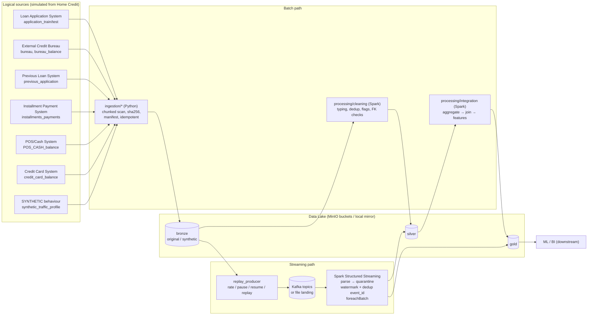
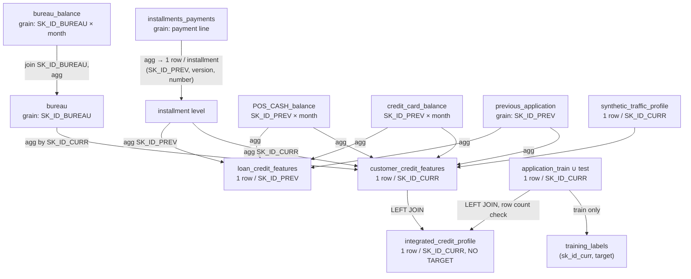
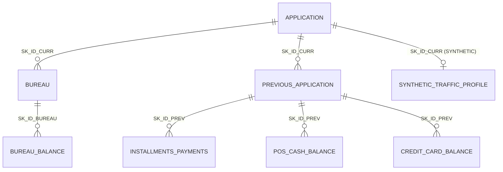

# ARCHITECTURE – Credit Risk Intelligence

## 1. Overall Architecture

Diagram summary: historical data flows along the batch path Bronze → Silver → Gold. The streaming path replays those same Bronze records as events, processes them in micro-batches, and writes into the same Data Lake.

## 2. Data Flow and Grain

Mandatory rule: no multi-row child table may be joined directly onto `application`. Each child table is aggregated to the parent key first. After every join, the pipeline asserts row counts before/after and key uniqueness; any single failure raises `IntegrationError` and halts the pipeline.

`installments_payments` has an extra intermediate stage because a single installment can have multiple partial payment rows. Rows are aggregated to the installment level first before counting late installments; counting directly on raw payment lines would inflate `installment_count`.

## 3. Table Relationships (ERD)

An ERD annotated with empirically measured numbers (orphan counts, max children per parent) is auto-generated at `reports/architecture/ERD.md` on every profiling run. `installments_payments`, `POS_CASH_balance`, and `credit_card_balance` also carry a redundant `SK_ID_CURR` column; profiling verifies whether it matches `previous_application.SK_ID_CURR` (via `SK_ID_PREV`), with results reported under *consistency* in `PROFILING_REPORT.md`.

## 4. Data Lake – Buckets and Directories

| Bucket / Directory | Contents | Format | Partitioning / File Count |
|---|---|---|---|
| `bronze/original/<source_id>/<table>/ingest_id=<id>/` | Byte-identical Kaggle file + `_metadata.json` | CSV (byte-identical, sha256) | By `ingest_id` (snapshot) |
| `bronze/synthetic/<source_id>/<table>/ingest_id=<id>/` | `SYNTHETIC` data, stored separately | CSV | By `ingest_id` |
| `bronze/_manifests/<table>.jsonl` | Ingestion run history (`SUCCESS`/`SKIPPED`/`FAILED`) | JSONL | — |
| `silver/<table>/` | Standardized data with DQ flags + lineage | Parquet (snappy) | Unpartitioned; repartitioned ≈ size / 128 MB |
| `silver/_quarantine/<table>/` | Rejected rows with `_reject_reason` | Parquet | 1 file |
| `silver/stream_events/` | Deduplicated streaming events | Parquet | `source_id`, `batch_id` |
| `silver/stream_quarantine/` | Malformed events | Parquet (file sink) | — |
| `gold/integrated_credit_profile/`, `gold/customer_credit_features/` | Integrated tables | Parquet | `dataset_split` (`train`/`test`) |
| `gold/loan_credit_features/`, `gold/training_labels/`, `gold/data_quality_report/` | Loan features, labels, DQ report | Parquet | 1–2 files |
| `gold/stream_customer_activity_delta/`, `gold/stream_batch_metrics/` | Streaming micro-batch outputs | Parquet | `batch_id` |
| `gold/stream_customer_snapshot/` | Current cumulative customer state | Parquet | 1 file |

Partitioning rationale:
- Avoid partitioning by `SK_ID_CURR`, which would create hundreds of thousands of tiny directories.
- `dataset_split` has only 2 values and ML pipelines always filter on it.
- Streaming outputs partition by `batch_id` so each micro-batch overwrites its own partition idempotently.

Delta Lake is optional (`CRB_LAKE_FORMAT=delta`); Parquet is the default.

## 5. Batch, Streaming, and Micro-Batch Comparison

| | Batch | Streaming (micro-batch) |
|---|---|---|
| Input | Latest Bronze snapshot per table | Events from Kafka topics or JSONL landing files |
| Scope | Full historical dataset | Individual events as they arrive |
| Engine | Spark DataFrame API (`processing/*`) | Spark Structured Streaming (`streaming/consumers/stream_processor.py`) |
| Trigger | On-demand (`scripts/run_pipeline.py`) | `--trigger 5` (every 5s) or `--trigger available-now` (drain available data and stop) |
| Deduplication | Exact-row dedup; PK dedup | `dropDuplicatesWithinWatermark(event_id)`; state stored in checkpoint |
| Late data | N/A | 10-minute watermark on `event_time`; late events dropped and counted |
| Recovery | Idempotent re-run (`sha256` + latest snapshot) | Checkpoint + partition overwrite by `batch_id` |
| Output | `silver/*`, `gold/*` | `silver/stream_events`, `gold/stream_*` |

Structured Streaming groups incoming events into small micro-batches (one DataFrame per trigger), allowing the same DataFrame transformation logic (JSON parsing → validation → aggregation) to be shared across batch and streaming paths.

## 6. Leakage Control (`TARGET` and Future Information)

1. **`TARGET` is isolated to `gold/training_labels`.** Automated checks prohibit `target` in any feature table, and `feature_columns.json` contains no `TARGET` column (verified by tests).
2. **Producer strips `TARGET`** from event payloads. The consumer also quarantines any incoming event containing `TARGET` (`forbidden_field:TARGET`).
3. **Point-in-time filtering:** relative time columns (`DAYS_*`, `MONTHS_BALANCE`) are anchored to the current application date. Rows with values `> 0` (occurring after application) are flagged `_after_application` in Silver and excluded before Gold aggregation, with counts logged in the DQ report.
4. **Train/test split:** preserves Kaggle's `dataset_split`. Labels exist only for `train`. ML pipelines must perform cross-validation within `train` and never leak `test` statistics during preprocessing/training.
5. **`SYNTHETIC` data** is generated independently of `TARGET` and all Home Credit attributes so it introduces no spurious risk signal (see `SYNTHETIC_DATA.md`).

Remaining risks to document in the final report:
- `bureau.CREDIT_DAY_OVERDUE` and `AMT_CREDIT_SUM_DEBT` are documented by Kaggle as values "at the time of application." The pipeline retains them because their exact update timestamps cannot be independently verified.
- `DAYS_CREDIT_ENDDATE > 0` represents the scheduled contractual maturity date (known ex ante), not a future event, so it is not excluded.
