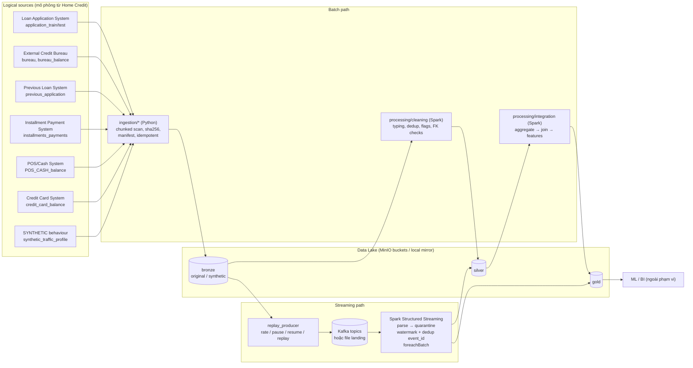
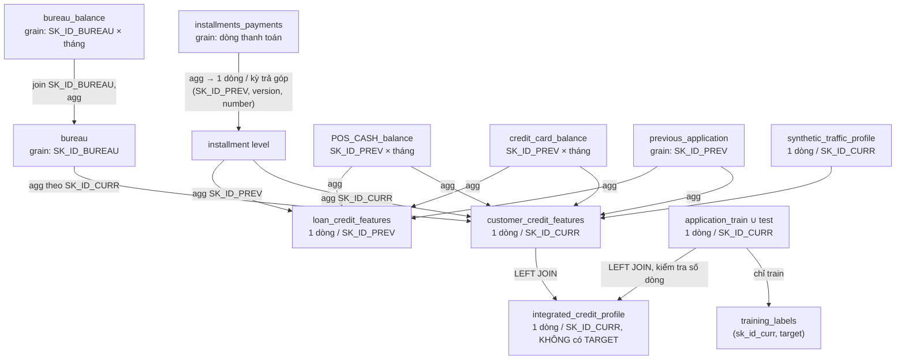
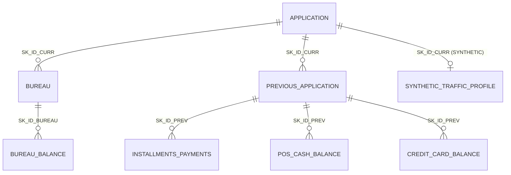

# ARCHITECTURE – Credit Risk Intelligence

## 1. Kiến trúc tổng thể

Đọc sơ đồ: dữ liệu lịch sử đi theo đường batch Bronze → Silver → Gold. Đường streaming phát lại chính các bản ghi Bronze thành event, xử lý theo micro-batch và ghi vào cùng một Data Lake.

## 2. Luồng dữ liệu và grain

Quy tắc bắt buộc: không bảng nhiều dòng nào được JOIN thẳng vào application. Mỗi bảng con được tổng hợp về đúng khóa trước. Sau mỗi JOIN, pipeline kiểm tra số dòng trước/sau và tính duy nhất của khóa; chỉ cần sai một lần là pipeline dừng (`IntegrationError`).

Riêng installments có thêm một tầng trung gian. Một kỳ trả góp có thể có nhiều dòng thanh toán từng phần. Vì vậy phải gom về mức kỳ trả góp trước, rồi mới đếm số kỳ trễ hạn. Đếm trực tiếp trên dòng thanh toán sẽ làm phồng `installment_count`.

## 3. Quan hệ giữa các bảng (ERD)

Bản ERD có số liệu đo thực tế đi kèm từng cạnh (số orphan, số con tối đa trên mỗi cha) được sinh tự động tại `reports/architecture/ERD.md` mỗi lần chạy profiling. Các bảng installments, POS và credit card còn mang thêm cột SK_ID_CURR dư thừa. Profiling kiểm tra cột này có trùng với SK_ID_CURR của previous_application (tra qua SK_ID_PREV) hay không; kết quả nằm ở mục *consistency* trong PROFILING_REPORT.

## 4. Data Lake – bucket và thư mục

| Bucket / thư mục | Nội dung | Định dạng | Partition / số file |
|---|---|---|---|
| `bronze/original/<source_id>/<table>/ingest_id=<id>/` | file Kaggle nguyên trạng + `_metadata.json` | CSV (byte-identical, sha256) | theo `ingest_id` (snapshot) |
| `bronze/synthetic/<source_id>/<table>/ingest_id=<id>/` | dữ liệu SYNTHETIC, tách riêng | CSV | theo `ingest_id` |
| `bronze/_manifests/<table>.jsonl` | lịch sử mọi lần ingest (SUCCESS/SKIPPED/FAILED) | JSONL | — |
| `silver/<table>/` | dữ liệu đã chuẩn hóa, có flag + lineage | Parquet (snappy) | không partition; repartition ≈ kích thước/128 MB |
| `silver/_quarantine/<table>/` | dòng bị loại kèm `_reject_reason` | Parquet | 1 file |
| `silver/stream_events/` | event streaming đã dedup | Parquet | `source_id`, `batch_id` |
| `silver/stream_quarantine/` | event lỗi định dạng | Parquet (file sink) | — |
| `gold/integrated_credit_profile/`, `gold/customer_credit_features/` | bảng tích hợp | Parquet | `dataset_split` (train/test) |
| `gold/loan_credit_features/`, `gold/training_labels/`, `gold/data_quality_report/` | | Parquet | 1–2 file |
| `gold/stream_customer_activity_delta/`, `gold/stream_batch_metrics/` | kết quả streaming | Parquet | `batch_id` |
| `gold/stream_customer_snapshot/` | trạng thái hiện tại theo khách hàng | Parquet | 1 file |

Lý do chọn partition:
- Không partition theo SK_ID_CURR, vì sẽ tạo hàng trăm nghìn thư mục nhỏ.
- `dataset_split` chỉ có 2 giá trị, và ML luôn lọc theo nó.
- Streaming partition theo `batch_id` để mỗi micro-batch ghi đè được chính phần output của nó (idempotent).

Delta Lake là tùy chọn (`CRB_LAKE_FORMAT=delta`); mặc định là Parquet.

## 5. Batch, streaming và micro-batch

| | Batch | Streaming (micro-batch) |
|---|---|---|
| Đầu vào | snapshot Bronze mới nhất của mỗi bảng | event từ Kafka topic, hoặc file JSONL trong landing zone |
| Phạm vi | toàn bộ dữ liệu lịch sử | từng event khi đến |
| Engine | Spark DataFrame API (`processing/*`) | Spark Structured Streaming (`streaming/consumers/stream_processor.py`) |
| Kích hoạt | chạy theo lệnh (`scripts/run_pipeline.py`) | `--trigger 5` (mỗi 5 s) hoặc `--trigger available-now` (xử lý hết dữ liệu đang có rồi dừng) |
| Trùng lặp | dedup theo bản ghi; PK dedup | `dropDuplicatesWithinWatermark(event_id)`; state lưu trong checkpoint |
| Dữ liệu trễ | không áp dụng | watermark 10 phút trên `event_time`; event trễ hơn bị loại và được đếm |
| Khôi phục | chạy lại idempotent (sha256 + snapshot mới nhất) | checkpoint + ghi đè theo partition `batch_id` |
| Đầu ra | silver/*, gold/* | silver/stream_events, gold/stream_* |

Structured Streaming không xử lý từng event riêng lẻ. Nó gom event thành các micro-batch nhỏ (một batch mỗi lần trigger), và mỗi micro-batch được xử lý như một DataFrame. Vì vậy cùng một logic DataFrame (từ JSON → kiểm tra → aggregate) dùng được cho cả hai chế độ.

## 6. Kiểm soát leakage (TARGET và thông tin tương lai)

1. **TARGET chỉ nằm trong `gold/training_labels`.** Có kiểm tra cấm cột `target` trong mọi bảng feature, và file `feature_columns.json` không chứa TARGET (có test).
2. **Producer loại bỏ TARGET** khỏi payload. Consumer cũng chuyển vào quarantine mọi event có `TARGET` trong payload (`forbidden_field:TARGET`).
3. **Point-in-time:** mọi cột thời gian tương đối (`DAYS_*`, `MONTHS_BALANCE`) được so với ngày nộp hồ sơ hiện tại. Dòng có giá trị > 0, tức xảy ra sau ngày nộp, bị gắn flag `_after_application` ở Silver và bị loại trước khi aggregate ở Gold. Số dòng bị loại được ghi trong DQ report.
4. **Train/test:** dùng đúng cách chia của Kaggle (`dataset_split`). Nhãn chỉ có cho train. Giai đoạn ML cần cross-validation trên train; không được dùng thống kê của test (ví dụ để chuẩn hóa) khi huấn luyện.
5. **Dữ liệu SYNTHETIC** được sinh độc lập với TARGET và với mọi thuộc tính Home Credit, nên không tạo ra tín hiệu rủi ro giả (xem `SYNTHETIC_DATA.md`).

Rủi ro còn lại cần nêu trong báo cáo:
- `CREDIT_DAY_OVERDUE`, `AMT_CREDIT_SUM_DEBT` của bureau là giá trị "tại thời điểm nộp hồ sơ" theo mô tả của Kaggle. Pipeline giữ nguyên các cột này vì không có cách kiểm chứng độc lập thời điểm cập nhật.
- `DAYS_CREDIT_ENDDATE` > 0 là ngày kết thúc theo hợp đồng (đã biết từ trước), không phải sự kiện tương lai, nên không bị loại.
