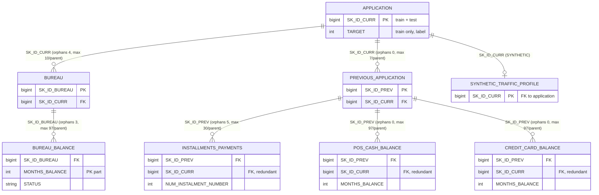

# ERD – Home Credit tables and logical sources

Measured on: **TEST FIXTURE (random values, NOT Home Credit)** (`/home/claude/credit-risk-bigdata/data/fixture/raw`), 2026-11-13T00:54:39+00:00.
Edge labels carry the orphan count and the maximum number of children per parent observed in the data.

